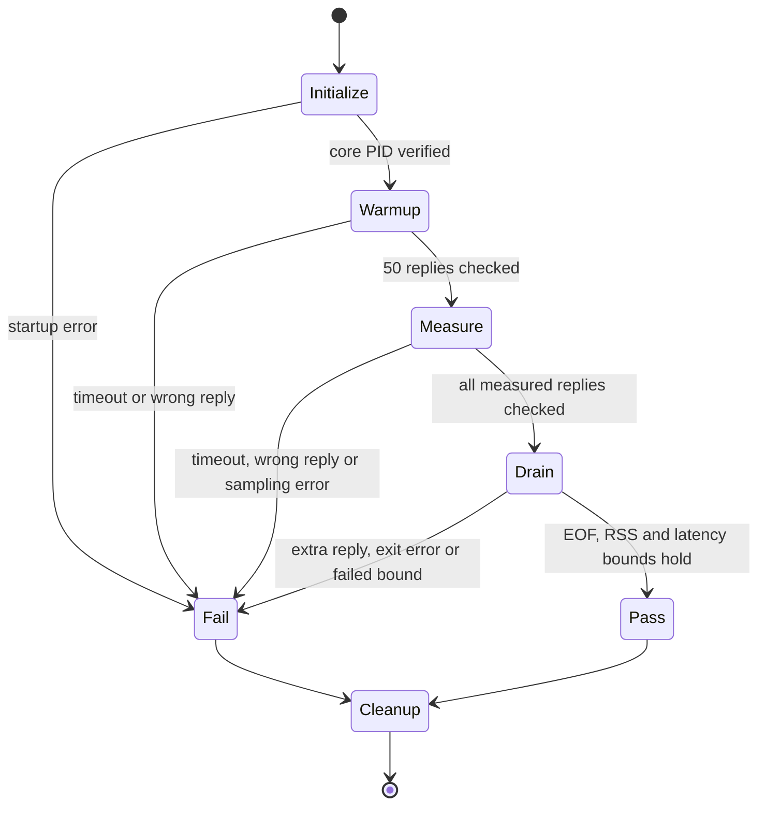

# Contributing

Thanks for helping. MailBend is small on purpose; please open an issue to
discuss larger changes before writing them.

Start with the [issue chooser](https://github.com/albertc71/MailBend/issues/new/choose)
for a bug report, feature request, or provider conformance report. Report suspected
vulnerabilities privately through [SECURITY.md](SECURITY.md).
Documentation fixes, tests, and synthetic fixtures are useful first contributions.
[Governance](GOVERNANCE.md) explains proposals, owner approval for every pull
request, and law changes.

The offline documentation checker validates selected declaration contracts for the
issue chooser and bug/feature forms, including their visible privacy warnings.
It does not parse `provider-report.yml`, validate every GitHub form field, or
verify GitHub's rendered forms. Review the provider form separately when changing
it; its diagnostic/report workflow is described in
[Provider reports](docs/PROVIDER-REPORTS.md).

## Ground rules

- Read [AGENTS.md](AGENTS.md): it holds the invariants every change must keep
  (verified TLS with no off switch, `EXAMINE` and `BODY.PEEK` for reads, no
  plain `EXPUNGE`, UID commands, discovered role folders, the
  native-helper boundaries and what Jev may do).
- Keep safety rules in `LAWS.bend`. Do not weaken a law to make code pass.
  The `tests/formal/budget-*-observers.bend` and `budget-observers.bend` modules,
  imported by `LAWS.bend`, are also part
  of that law contract: review changes to `admit_all`, `lengths_exact`,
  `Within` and the other observers as changes to the laws, and explain them
  in the pull request. Do not weaken an observer or premise to make a proof
  pass. The budget mutation check fingerprints `tests/formal/budget-*.bend`,
  `tests/formal/scalar-*.bend` and `tests/formal/json-size-*.bend`, including
  these observer modules, to check that its run leaves the checkout
  unchanged; this is not an approval gate for later contract changes.
- Never put real credentials, account addresses or mail in code, tests,
  fixtures, issues or pull requests. Tests run against the local fake server
  (`tests/fake_mail_server.py`) with a synthetic password, and CI scans the
  tree and history for secrets (`scripts/scan-secrets.sh`).
- Maintainers: never build or run an unreviewed pull request where real mail
  credentials are set; CI has none, so it is the place to run them. Read
  changes to the paths in [.github/CODEOWNERS](.github/CODEOWNERS) with
  particular care.
- The `permanently-delete` confirmation is not a person's approval (the agent
  supplies it); do not describe it, any tool argument or a Jev answer as
  one.
- Report vulnerabilities privately as described in [SECURITY.md](SECURITY.md).

## Checks

Run these before opening a pull request. CI runs proofs, unit tests, runtime suites and Rust checks on Linux x86_64
and aarch64. MailBend needs Linux 5.6+ and glibc 2.34+ on either architecture.
Fuzzing, the dedicated mutations job and the
secret scan stay on x86_64. Both architectures run `cargo deny check` and
the source checks in
[.github/workflows/ci.yml](.github/workflows/ci.yml). The native helpers
need the Rust release pinned in `native/rust-toolchain.toml`. The end-to-end
schema checks need Python `jsonschema` (`python3 -m pip install jsonschema==4.26.0`).
Use Python 3.13.18 (the CI pin), or a runtime containing the
[CPython #128110 fix](https://github.com/python/cpython/issues/128110). The MIME oracle
checks this capability: older `email.policy.default` incorrectly inserts whitespace
between adjacent encoded words in display names.
The scheduled recipe test also needs `jq` and `flock` from util-linux.
The scale contract checks need GNU `time` (`sudo apt-get install time` on Ubuntu).

```sh
scripts/install.sh --install-bend --install-rust  # build; installs Bend and Rust if missing
sh scripts/scan-secrets.sh                        # redacted secret scan, tree and history
python3 scripts/check-docs.py                     # documented names and skill tool arguments resolve
python3 tests/test-docs.py                        # drift mutations and client snippets
python3 tools/gen-llms.py --check                  # complete source index is current
python3 tests/test-llms.py                         # offline index CLI and failure paths
python3 tests/test-plugin.py                      # plugin declarations and isolated launcher fixture
python3 tests/test-toolchain-installers.py        # pinned asset URLs and installer refusal paths
sh scripts/install-lean.sh                        # once: the Lean that bend --verdict needs
bend PROOF.bend --verdict                         # must print "ALL PROOFS CHECK"
bend src/tools.bend --verdict                     # retain tool-layer kernel coverage
bend tests/formal/tool-laws.bend --verdict        # tool-layer laws kept out of PROOF.bend
python3 tests/formal/check-policy.py              # pure policy boundary and rejected mutations
python3 tests/formal/check-smtp-tls.py             # bounded model plus rejected mutations
python3 tests/formal/check-facts.py                # literal source/span proofs reject three mutations
python3 tests/formal/check-role-folders.py         # role-folder proofs reject broken resolution
python3 tests/formal/check-response-image-budgets.py # budget proofs reject broken admission/cuts
python3 tests/test-writing-laws.py                # malformed guide fences fail closed
python3 tests/formal/check-writing-laws.py         # compile the guide and reject a broken plan
python3 tests/formal/check-plan-wire-mutations.py   # exact caller guards and UID wire commands
python3 tests/formal/check-plan-coverage.py        # public plan references and command construction
python3 tests/formal/test-plan-coverage.py         # source-gate negative controls; no Bend needed
python3 tests/test-unit-runner.py                 # offline unit scheduling and cleanup contracts
sh tests/run-unit.sh
python3 tests/test-facts-extraction.py            # deterministic hostile inputs and exact spans
python3 tests/test-soak-contract.py                # soak verdict, deadlines and cleanup controls
python3 tests/test-soak.py --profile short         # synthetic session soak after build
python3 tests/test-mcp-schema-comparison.py        # bounded comparison startup and descendant cleanup
python3 tests/test-scale-contract.py               # bounded scale lifecycle and comparison controls
python3 tests/test-scale-baseline.py               # historical selected baselines match apparatus
python3 -I tests/test-scale-pair.py                   # fixed-reference paired provenance and failure controls
python3 tests/test-image-budget.py                 # helper MAX_REQUEST equals Bend's image cap
python3 tests/test-image-assets.py                 # the fake TypeSafe's image rules
python3 tests/test-image-replies-probe.py           # compile both image probe variants, tiny smoke only
bash tests/test-transport.sh
python3 tests/test-cloud-network.py
python3 tests/test-stdio.py
python3 tests/test-demo.py                        # isolated loopback demo, MCP flow and cleanup
python3 tests/test-install.py
python3 tests/formal/check-install-swap.py
python3 scripts/check-native-hardening.py         # installed native ELF metadata, after install.sh
python3 tests/test-native-hardening.py             # real C-linked positive and negative controls
python3 tests/test-posture-inventory.py           # native egress changes need an explicit audit
python3 scripts/check-fuzz-lock.py               # shared native dependency identities and edges
python3 tests/test-fuzz-lock.py                   # offline lock comparison fixtures
python3 tests/test-posture.py                     # offline capability report and redaction
python3 tests/test-clock.py                       # outgoing clock failures, no counter or mail effects
python3 tools/gen-unicode-tags.py --check         # pinned Unicode flag identifiers
python3 tests/test-output-schema.py               # strict result contract variants
python3 tests/test-cli-tools.py                   # credential-free filtered CLI discovery
python3 tests/test-hook.py                        # offline Claude hook input and prompt contract
python3 tests/test-plugin.py --runtime             # real plugin-resolved hook and synthetic MCP after build
python3 tests/formal/check-hook.py                # hook laws reject allow and missed prompts
python3 tests/formal/check-reply-marking.py        # post-acceptance marking transition laws
python3 tests/test-mime-corpus.py                  # synthetic MIME/i18n and independent composition oracle
python3 tests/test-mime-corpus.py --nested-resources  # also the 16 MiB nested parse and view limits
python3 tests/test-harness-output.py               # test-harness transport diagnostics and redaction
python3 tests/test-facts.py                       # literal facts, fake loopback mail, CLI
MAILBEND_TEST_MCP=1 python3 tests/test-facts.py   # the same facts through structured MCP
python3 tests/test-e2e.py
MAILBEND_TEST_MCP=1 python3 tests/test-e2e.py --tool-scenarios-only  # tools through structured MCP
python3 tests/test-scheduled-recipes.py            # fake-only one-shot recipes; no timers installed
(cd native && cargo fmt --all --check && cargo clippy --all-targets --locked -- -D warnings && cargo test --locked)
```

The offline fuzz-lock guard compares dependencies reachable from the local
`mailbend-net` and `mailbend-tls` packages in `native/Cargo.lock` with
`native/fuzz/Cargo.lock`. Shared package names, versions, sources, checksums and
resolved dependency edges must match. Extra fuzz-only packages and edges are
allowed, including extra dependencies on shared packages. The guard validates
package records in both locks and resolves references on shared parents, including
their extra fuzz edges. It does not resolve references on entirely fuzz-only
parents; Cargo remains the full-lock validator. Lock data cannot establish equal
features, build targets, local source paths or runtime behavior. The guard also
reads `native/fuzz/Cargo.toml`, or the fixture supplied with `--manifest`. Its
supported path inventory is exactly the unaliased normal dependencies
`mailbend-net = { path = "../mailbend-net" }` and
`mailbend-tls = { path = "../mailbend-tls" }`. Other path dependencies, including
build, dev and target-specific ones, package aliases, workspace inheritance and
workspace dependency or member lists fail with an inventory error. Source
overrides through `patch` or `replace` and legacy underscore dependency-table
spellings are unsupported too. Update the
guard and its fixtures when expanding that scope. Registry-only extras remain
allowed. This assertion does not replace Cargo's locked manifest validation.

The unit runner stays serial by default. To opt into bounded parallel execution,
run `sh tests/run-unit.sh --jobs 2`. The decimal job count must be between 1 and 8.
The runner needs Python 3, Linux `/proc`, and the existing `bend`, `sed`, `cmp`,
and `diff` commands.
It runs sorted unit files in batches of at most that many compiler processes.
A batch finishes and reports in filename order before the next batch starts, so
idle slots do not refill while another file in the batch is still running.
Failures still allow later files to run. A test passes only when Bend exits
successfully and its combined stdout and stderr match the `#|` lines byte for byte.
Failure diagnostics retain the first 20 lines of `diff` output.

Each run keeps compiler output in private temporary files. Before comparing an
output file, it terminates any descendants left in that compiler's process group.
It retains the unreaped leader until the group stops, then reaps and forgets it.
This keeps process-group IDs reserved until the last signal and prevents late
output writes after comparison. Launch or file errors,
SIGINT, and SIGTERM stop new launches and terminate owned process groups, with a
half-second grace per group before SIGKILL. A group still running one second
after SIGKILL is an infrastructure failure. The runner reaps direct children and removes its
temporary files before exiting. An uninterruptible kernel wait can delay reaping,
error reporting, and cleanup of other groups; shutdown has no guaranteed time bound.
This cleanup cannot cover SIGKILL of the runner
itself or descendants that deliberately escape their process group. Ordinary
compiler failures produce the final pass/fail count; infrastructure errors and
interruptions exit without that summary.

CI exercises the synthetic scheduling and cleanup contracts on both architectures.
Its actual Bend unit invocation remains serial until separate x86-64 and ARM64
resource measurements support changing it. This option makes no speedup claim.

When changing `skills/mailbend/`, run `skills-ref validate skills/mailbend` with
the [Agent Skills reference validator](https://github.com/agentskills/agentskills/tree/main/skills-ref).
Keep the entrypoint under 300 lines, use portable frontmatter without
`allowed-tools`, and retain explicit human approval before sends and deletes.
The documentation check validates tool-scoped names and arguments against
`tools/gen-schema.py`; it is not a behavioral evaluation of an agent.

When changing shipped plugin behavior, including `.claude-plugin/` or
`hooks/`, bump `version` in `.claude-plugin/plugin.json` and update the version
assertion in `tests/test-plugin.py` and the plugin guide. The
[upstream version contract](https://code.claude.com/docs/en/plugins-reference#version)
keeps repository-marketplace users on the declared version until it changes.
Also run these checks with Claude Code 2.1.295 or later:

```sh
claude plugin validate . --strict
claude plugin validate .claude-plugin/marketplace.json --strict
```

Plugin tests never start Claude or use a live account. The lightweight suite
guards manifest declarations and uses a Python harness to substitute paths
and merge environments against a fake installation. Shell-metacharacter
paths exercise Python's argv handling, not Claude's interpolation, process
launching or environment inheritance. The runtime suite uses that same
harness with this checkout's real launcher, built binaries, and loopback mail
fixture. Neither these tests nor the validator proves client loading or prompt
display. Follow the
[manual plugin checks](docs/CLAUDE-PLUGIN.md#verify-the-connection-and-prompt)
before relying on a particular client version.

The first end-to-end run includes the fixed CLI, diagnostic and MCP protocol
checks. The second repeats the tool scenarios through structured MCP without
repeating those fixed routes. Omit `--tool-scenarios-only` for a standalone
complete run, including when `MAILBEND_TEST_MCP=1` is set.

CI runs source checks and unit tests, kernel-rechecked proofs, proof mutation
checks, CLI, structured MCP and support suites on isolated standard Ubuntu
runners. Each runtime runner builds its own binaries
from the checked-out revision. This repeats build work to avoid shared-state
races and artifact storage. Rust and fuzz checks remain separate. Source,
proof and mutation lanes each install their own toolchain. The final
`checks` job requires every lane to succeed, including Rust and fuzz; skipped
or cancelled lanes do not count as a pass.

The goal is at most ten minutes of CI execution. This is a measurement target,
not a timeout or permission to omit tests. Record queue time separately.

The [bounded SMTP model](.agents/skills/smtp-tls-proofs/SKILL.md) checks an
abstraction of authentication ordering, not the Rust implementation or
cryptography. Its mutation check verifies that broken model transitions fail.
The transport suite exercises the actual helper.

The plan-coverage check runs offline without Bend. Every `plan_*` definition in
`src/ops.bend` referenced by `main.bend` or a file under `src/` must also have a
reference inside a `law` statement in `LAWS.bend`. Internal-only helpers are
excluded. An externally referenced dotted helper still needs coverage. Comments
and string literals do not count, and a function-value reference counts even
without a call.
This checks the presence of a reference, not the strength of a law or its proof.
A tautological law referencing the plan satisfies this check.

The same check rejects IMAP command construction in production files outside
`src/ops.bend` and `src/imap.bend`. It derives constructor names from `I.Cmd`,
resolves import aliases, and permits constructor patterns before a `case` colon.
It also rejects external references to command-returning defs in `src/ops.bend`
unless their names start with `plan_`. External references to command-returning
defs in `src/imap.bend` are rejected even if their names start with `plan_`:
plans belong in `src/ops.bend`. This uses declared return types that name the
IMAP `Cmd` type, directly or inside a container. Every def in `src/ops.bend` and
`src/imap.bend` must have an explicit, nonempty return annotation. This requirement
does not apply to other modules or proof files. A `Cmd` parameter alone does
not make a def command-returning. Return annotations support named types and
generic containers with numeric multiplicities such as `List<&2, I.Cmd>`.
Other return-type syntax fails closed.

In `src/ops.bend` and `src/imap.bend`, the check also rejects data fields whose
declared types name the IMAP `Cmd`, directly or inside a container. This prevents
a local record from hiding a command-returning helper behind its record type.
The canonical `Cmd` declaration in `src/imap.bend` is exempt. Other modules may
keep command records, such as the tool layer's plan previews. The field check
supports nongeneric `type Name is Data` declarations with named field types and
generic containers. It checks field tokens and bracket balance, not the full
Bend type grammar. Unsupported declaration forms or field tokens fail closed.
It resolves import aliases but does not infer return types, expand type aliases,
follow imported record fields, or analyze higher-order values and call chains.
An imported record can still hide a command. This check does not prove that
plan output reaches the transport unchanged.

Proof and test files remain free to construct expected commands. This source
reader is not a Bend parser or type checker. It supports the repository's
explicitly aliased local imports and fails on an unsupported import or relevant
declaration. Qualified plan bindings are
rejected. A qualified plan name immediately before a colon is also rejected
as an ambiguous binding or annotation. Helper definitions in `LAWS.bend` do
not supply coverage. Add a fixture to
`tests/formal/test-plan-coverage.py` when extending its supported syntax.
The existing proof and mutation checks remain necessary.

The documentation check runs offline with Python 3.11 or later. It checks law
references, environment-variable names, CLI verbs in both usage texts, and every
`src/*.bend` path in the architecture's Layers section. Cite laws with Markdown
links whose labels are the exact law names and whose targets are `LAWS.bend`.
The check also recognizes `law` or `laws` followed by backtick names, a backtick
name followed by `law`, and `Laws.`-qualified references. It checks names, not whether
prose claims follow from the laws.

The bug and feature forms and issue chooser configuration use JSON syntax,
which is valid YAML, so the same offline check can parse them without another
dependency. It checks required fields, privacy warnings, and the private security
route. The documentation tests reject broken declarations and contributor links.
These source checks do not submit issues or verify GitHub's rendered form.

Environment coverage uses exact `MAILBEND_*` string literals in `main.bend`,
`src/*.bend`, and native Rust source, excluding comments and `cfg(test)` modules.
This includes names passed through helper functions and constants, not just
direct environment reads. List each name in `.env.example`, including forbidden
variables in explanatory comments. Update the checker if a source syntax change
moves configuration names out of string literals.

When the checkout is on a filesystem without Linux `O_TMPFILE` support
(for example WSL's `/mnt/c`), run the end-to-end fixtures on a native Linux
filesystem: `MAILBEND_TEST_TMPDIR=/tmp python3 tests/test-e2e.py`. This changes
only the temporary fixture directory; the attachment sandbox checks remain
in force.

### Native ELF checks

`python3 scripts/check-native-hardening.py [BIN_DIRECTORY]` checks the four
installed native helpers, defaulting to this checkout's `bin/` regardless of
the current directory. It requires GNU `readelf` from binutils. The fixture
suite also requires a C compiler available as `cc`; missing prerequisites
fail rather than skip. Ordinary CI runs both checks after installation in
the support suite on x86_64 and aarch64.

Each helper must be a little-endian ELF64 PIE for a supported architecture,
with GNU_RELRO, immediate binding, a present non-executable GNU_STACK and
the matching Linux interpreter. Direct NEEDED entries may contain only
`libc.so.6`, `libgcc_s.so.1` and that architecture's loader basename. The
check reads ELF metadata without executing the helpers or using `ldd`. It
does not inspect transitive dependencies, prove memory safety or exploit
resistance, or establish library trust. The Bend core is outside this check.

After editing `tools/gen-schema.py`, regenerate `src/schema.bend` with
`python3 tools/gen-schema.py`, and update the length and hash pinned in
`tests/unit/schema.bend`.

## Documentation source index

Run `python3 tools/gen-llms.py` after adding, removing or renaming documentation,
or changing a page title or README section heading. Commit the resulting
`llms.txt`. `python3 tools/gen-llms.py --check` compares exact bytes without
writing; the documentation source-checks CI step runs it and
`python3 tests/test-llms.py`. Both commands are offline and use only Python's
standard library. `--root PATH` selects another repository fixture independently
of the working directory.

The index discovers README, its H2 sections in source order, every `docs/**/*.md`
page, and every `skills/mailbend/**/*.md` page. Page paths are sorted within each
group. Internal `.agents` skills are excluded. `docs/plans/` has a separate
proposal/history list and is not evidence that a feature is implemented. This
is a source index only; it does not publish a site or copy document bodies.

The reader supports single-line ATX headings with up to three leading spaces,
optional closing hashes, and backtick or tilde fences. Pages need a nonempty
first heading at H1. README anchors support ASCII plain-text headings: lowercase,
remove punctuation except hyphens/underscores, replace spaces with hyphens,
and suffix collisions in source order across all heading levels. It is not a
CommonMark parser: Setext headings, HTML, inline links, entities and other
rendered inline markup are not interpreted. Keep README headings in the supported
plain-text subset. Every README heading level is checked because each consumes
an anchor. Brackets, angle brackets, emphasis/code/escape markers (`*`, `_`,
backticks and backslashes), double tildes and entity references are rejected
before writing. Ordinary punctuation such as parentheses and slashes is allowed.
README HTML blocks and multiline comments are also rejected outside fences;
one-line body comments such as claim markers remain supported. Standalone runs
of hyphens or equals signs (up to three leading spaces) are rejected outside
fences to avoid Setext headings consuming anchors; this also rejects some
horizontal rules. Blockquote/list-contained headings and other container syntax
are not parsed or comprehensively rejected. Keep README headings at the document
level in the supported ATX subset; these checks are not general Markdown validation.
This conservative restriction applies only to README anchors, not page-title
labels elsewhere. Labels are Markdown-escaped and destinations URL-encoded.
Invalid UTF-8, missing titles, unclosed fences, or missing mandatory README,
CLI, recipes, frameworks or skill entrypoint fail before replacing the index.

## MIME and charset regressions

Every MIME or charset fix adds or deliberately updates a synthetic message and its
expected JSON in [`tests/corpus/`](tests/corpus/README.md). Preserve raw fixture bytes.
Record provenance and license, distinguish malformed-input recovery from valid mail,
and link known-wrong pins to an issue. Never update expected results from the tested
parser automatically. The corpus runner and the existing end-to-end suites also parse
composed messages with Python `email.policy.default`; a disagreement fails the check.

## Adding a tool

1. Add its `Op` in `src/ops.bend` (`all_ops`, `name`, `is_read_only`,
   `needs_jev`), and any IMAP commands it needs as a `plan_*` def there.
2. Add its schema and description to `tools/gen-schema.py` and regenerate
   `src/schema.bend`. Every tool that is not read-only gets `dry_run`.
3. Run it from `run_op` in `src/tools.bend`, through `preview_or_run` when
   it changes mail.
4. State what it must never do as laws in `LAWS.bend`, prove them in
   `PROOF.bend`, and update the tool-list laws, which name every tool.
   Laws are the owner's: explain each new or changed law in the pull
   request. Follow [Writing laws](docs/WRITING-LAWS.md) for proof patterns,
   vacuity checks, and an executable example.
5. Decide what Jev does in it. Most tools never ask Jev. A tool that sends
   or deletes must reach SMTP or the delete plan only through
   `Jev.outbound_checked` or `Jev.delete_checked`, which the CI source
   checks enforce; its questions are `Veto`s like `outgoing_vetoes` in
   `src/jev.bend`: a high answer vetoes, and a missing one blocks too. A
   read that shows messages may add notes through `annotated` in
   `src/tools.bend`.
6. Add end-to-end cases in `tests/test-e2e.py` (with Jev off and on when it
   asks Jev), and list it in the README's tool table (and in
   [docs/JEV.md](docs/JEV.md) when it asks Jev).

## Bend style

The Bend files follow `bend guide` and Base (`bend base`). In particular:

- A file opens with a short comment saying what it is, then a blank line,
  then its imports. Sections are a title underlined with `-` (or `=` for a
  group of sections), with a blank line above and below.
- Lines in `src/`, `main.bend`, `LAWS.bend` and `PROOF.bend` stay within
  100 columns; the generated `src/schema.bend` keeps 80. Unit tests are
  exempt, as their expected-output lines cannot wrap.
- Lists are matched as `Nil{}` and `h <> t`.
- Write `+` only on a value that is used more than once on some path.
- A helper is named after the def it serves, with a dotted suffix for its
  role: `.go` for the loop, `.step` for one step of it, `.fin` for the
  result from its final state, `.if` for a branch on a computed Bool or
  check (a problem string, empty when the check passes), `.put` for a
  branch on another computed value, `.run` for the IO work once the checks
  pass, or a noun for any other part. A def that computes the problem
  string keeps a descriptive noun name, such as `uidv_problem`.
- Arguments are built before the call, so `Bool.pick`, `&&` and `||` build
  both sides. Where a side is costly, or both sides recurse, pass the test
  to a helper that matches it.
- Where the first of several problems wins, new code checks them in a
  `do Result` block, which stops at the first; the existing `first_of`
  chains stay.

Use [Conventional Commits](https://www.conventionalcommits.org/) messages
(`fix:`, `feat:`, `docs:`, ...). By contributing you agree that your work is
licensed under the [MIT License](LICENSE).

## Bump an installer pin

For an installer or compiler pin update, change the version and both
architecture checksums together in the corresponding script:

- Bend: always follow the [Bend upgrade runbook](#upgrade-bend).
  `BEND_VERSION` selects the compiler itself, not a separate installer. Update
  it and both `BEND_SHA256` values in `scripts/install-bend.sh` through that runbook.
- elan: `ELAN_VERSION` and both `ELAN_SHA256` values in `scripts/install-lean.sh`.
- rustup: `RUSTUP_VERSION` and both `RUSTUP_SHA256` values in `scripts/install-rust.sh`.

Verify each downloaded x86_64 and aarch64 asset against an upstream-published
SHA256 for that exact version and asset:

- Bend and elan: inspect the matching asset's `digest` field in the official
  GitHub release API for [bendlang/bend](https://api.github.com/repos/bendlang/bend/releases)
  or [leanprover/elan](https://api.github.com/repos/leanprover/elan/releases).
- rustup: fetch `rustup-init.sha256` beside `rustup-init` under
  `https://static.rust-lang.org/rustup/archive/<version>/<target>/`, for each
  of `x86_64-unknown-linux-gnu` and `aarch64-unknown-linux-gnu`.

Do not assume a future release publishes both digests. If either is missing,
stop the bump and record the missing upstream evidence for review. A locally
computed checksum alone is not upstream verification; compare it with the
published value. These HTTPS sources are not an independent signature check.

Update the corresponding expected URLs and checksums in
`tests/test-toolchain-installers.py`, keeping those expectations independent
of the installer source. Run that test and the [contributor checks](#checks),
then require exact-head native x86_64 and aarch64 CI before review completion.
A passing mock test checks selection and refusal paths, not upstream provenance.

Changing elan or rustup does not by itself change the installed Lean or Rust
version. Keep `LEAN_TOOLCHAIN` and `RUST_TOOLCHAIN` unchanged unless that
compiler upgrade is also intended and verified. For Bend compiler changes,
follow the full [Bend upgrade runbook](#upgrade-bend) below. Installer scripts
are also pinned by the paired-scale preflight. Complete its separately reviewed
policy migration before treating a helper update as ready:

1. Replace the complete literal `CANDIDATE_HELPER_TUPLE` in
   `tests/scale_pair.py` with the reviewed SHA256 values in path order:
   `scripts/install-bend.sh`, `scripts/install-rust.sh`, then
   `scripts/install-lean.sh`. Review all three files as one revision, including
   unchanged helpers. Never derive approved hashes dynamically from candidate
   files or bypass the refusal of unreviewed or mixed tuples.
2. Update [Reviewed candidate installer migration](tests/SCALE.md#reviewed-candidate-installer-migration-148)
   with the source revision and scope. Preserve the historical #148 record;
   for a new migration, rename the section to cover all reviewed migrations,
   append the new record, and update this link to the renamed heading.
   Update the literal tuple assertion in `tests/test-scale-pair.py` and any
   other controls that depend on that tuple. Keep rejection and alias controls.
   Run `python3 tests/test-scale-pair.py`.
3. Require the paired comparison to pass on the exact proposed PR head, as
   well as native CI. Editing `tests/scale_pair.py` triggers
   `.github/workflows/scale-compare.yml` on the PR; editing installer scripts
   alone does not. The normal `checks` aggregate excludes `scale`, so green
   ordinary CI alone cannot validate a helper migration. If policy and helper
   changes use separate PRs, each needs review, and the final combined helper
   head needs its own paired pass before it lands. If that helper PR does not
   trigger the comparison, dispatch `.github/workflows/ci.yml` at its candidate
   ref with `scale=true` and `record_scale=false`. Keep the fixed reference and
   verify that the run tested the exact proposed head.

Keep the fixed reference, frozen apparatus and `install.sh` checks intact.
Ordinary CI's source checks run preflight on the checkout's actual launcher, so
any launcher byte change, including a comment edit, fails until those exact bytes
receive a separately reviewed migration. See the
[report usage-comment migration](tests/SCALE.md#reviewed-report-usage-comment-migration-292)
and the earlier [candidate hook launcher migration](tests/SCALE.md#reviewed-candidate-launcher-migration-110).
The paired job installs Bend from the reference helper for both builds;
admitting candidate helper bytes does not validate a new compiler in that
paired run. Compiler acceptance still requires the full Bend runbook and
native checks on the intended compiler.

## Upgrade Bend

Use the [Bend upgrade canary](.github/workflows/bend-canary.yml) as an early
warning, not as an upgrade approval. It runs on Mondays at 05:23 UTC and on
manual dispatch after the workflow reaches the default branch. It does not
run on pull requests. Never add its job to required checks.

The default candidate is the latest stable official Bend release. A manual
run can select an exact `N.N.N` version. The workflow records the archive
SHA256 and checks it against the release API before running it. This is an
observation of a moving release, not the reviewed checksum pin used by normal
CI. The candidate has a separate home and no mail credentials. Only
GitHub-owned actions run, with read-only repository permission and no saved
checkout credential.

1. Open the latest canary summary. Check the Bend version, archive SHA256,
   requested Lean toolchain, and every step outcome. A failed, skipped, or
   cancelled check is not a pass. Inspect the failing step's log. The smoke
   covers existing fake-server reads, CLI argument handling, and MCP framing
   in both CLI and MCP modes. It does not replace the full contributor suite.
2. Read the [official changelog](https://github.com/bendlang/bend/blob/main/CHANGELOG.md)
   for every release between the current pin and the candidate. In the upgrade
   PR, list each relevant entry and the test that checks it. Check these uses
   even when the changelog does not name a break:
   - `Process.run` in `src/tools.bend`, and helper exit or signal status in
     `src/policy.bend`.
   - `IO.args`, `IO.exit`, and compiled runtime options in `main.bend` and
     `scripts/mailbend`. Keep application arguments separate from `+RTS` and
     `-RTS` runtime options.
   - `IO.get_env` in `src/tools.bend` and configuration refusal paths.
   - `--verdict`, finite-parameter proof checks, and kernel cache invalidation.
3. Use a disposable checkout and an empty home without real credentials for
   candidate runs. Keep its `bin/bend` beside its `bend2` directory. The
   installer prepends `$HOME/.bend/bin`, so changing only `PATH` can select the
   old compiler. Clear `BENDTT`; a prebuilt kernel can bypass the Lean check.
   Run the candidate's `bend version` before each reproduction.
4. Run a tiny valid program with `--verdict` before installing Lean. Its
   infrastructure error states the required `leanprover/lean4:vN.N.N`
   toolchain. The canary does this with an empty home and a failing Lean shim.
   If the diagnostic format changes, update and test the discovery step.
   Do not guess the version or remove the proven-kernel check.
5. When the candidate checks pass, update `BEND_VERSION` and both architecture-specific `BEND_SHA256`
   values together in `scripts/install-bend.sh`. Verify the downloaded Linux
   x86_64 and aarch64 archives against their official release digests. Set `LEAN_TOOLCHAIN` in
   `scripts/install-lean.sh` to the version the candidate requests. Follow
   [Bump an installer pin](#bump-an-installer-pin) to update the independent
   URL and checksum expectations and review any paired-scale pin migration.
6. Run every [contributor check](#checks) on the proposed pins, including
   `bend PROOF.bend --verdict`. Require `ALL PROOFS CHECK`. Run normal CI on
   the exact PR commit. Do not weaken laws, expected output, or security
   checks to accept a compiler change.
7. Include the old and new versions, both archive hashes, the requested Lean
   version, changelog coverage, test results, and unresolved limits in the PR.
   Obtain review before merging. A green canary alone does not authorize a pin
   change, a release, or a deployment. Revert both toolchain pins together if
   an upgrade must be withdrawn, then rebuild and restart the MCP process.

### First Bend 2.0.39 observation

On 31 October 2026, a local isolated Linux x64 run tested source commit
`bbe96fe33e7660b980606ad470a02d25669ea284` with the
[official 2.0.39 archive](https://github.com/bendlang/bend/releases/tag/v2.0.39).
Its SHA256 was
`6cf462fd8f70b094a4950ebb709a9c4ffd8f1d1189d9cedf1fd63cd5d041c7ab`,
verified against the release API. `bend version` returned `bend 2.0.39`.
The isolated verdict probe requested `leanprover/lean4:v4.34.0`.

| Check | Observed result |
| --- | --- |
| `bend main.bend --check-only` | Failed on the duplicate `Text` constructor at `src/jev.bend:100`. |
| `bend PROOF.bend --verdict` | Failed on the same declaration before proven-kernel rechecking. |
| `sh tests/run-unit.sh` | 14 passed, 11 failed. The failing imports reached the duplicate declaration. |
| `scripts/install.sh` | Native helpers built. The safety-law check rejected the same declaration, so no fresh core was published. |
| Fake-server smoke with the candidate | Skipped because the fresh candidate build failed. |

The compatibility failure is tracked in [#207](https://github.com/albertc71/MailBend/issues/207).
It is not an upgrade recommendation. The canary
adds no product fix for it. Normal CI remains on Bend 2.0.35 and its existing
Lean pin. This first observation is a local report, not a claim that the
scheduled GitHub workflow has run. Retain the workflow run summary and logs
when reproducing it on GitHub.

## MCP session soak

After building, run `python3 tests/test-soak.py --profile short` (CI) or
`python3 tests/test-soak.py --profile long` (manual). These use one compiled
MCP core and the local TLS fake server, never a provider account. Existing
mail settings are removed from the child environment. The test password and
mail are synthetic, and the output contains only measurements.

Each profile warms up with 50 requests, then measures 500 or 5,000 requests.
Every ten-request burst is written before replies are read, with the same mix
of tool discovery, probe, search, get, flag/unflag and expected failures.
This is a synthetic stress pattern; real clients' concurrent request behavior
has not been verified. All replies must arrive once, in request order, with
the expected operation result. Extra replies after the final request fail.

The core's RSS is sampled every 100 ms. After warm-up it must stay at most
1 GiB and within 256 MiB of the warm-up peak. The last tenth's p95 latency
must not exceed three times the first tenth's p95. Latency includes queueing
from the burst write; both comparison windows have the same request mix.
The short run has a 180-second request budget, the long run 1,800 seconds,
plus bounded setup and shutdown. A missing reply fails after 30 seconds even
when the total budget remains. Earlier hosted runs approached or exceeded
180 seconds. After #262's generated tool listing and #264's named input-schema
selection, the
[integrated required CI run](https://github.com/albertc71/MailBend/actions/runs/41903506215)
completed the same 50 warm-up plus 500 measured requests in 7.623 seconds on
x86-64 and 10.591 seconds on ARM64. The workload and every bound were unchanged.
These are observations from one short-run campaign, not a universal flake rate
or a guarantee for other runners; both architectures must pass their own lane.
CI runs four separate required runtime lanes per architecture, allowing all
eight matrix entries in parallel rather than serializing soak after MCP
scenarios. Runner availability can still cause queueing. This adds a build per
architecture but does not guarantee a particular overall CI duration. JSON
output records the RSS curve, p50/p95,
drift ratio and elapsed time. Both success and failure output include counts
and reply-gap summaries by fixed synthetic operation. Gaps span consecutive
replies within a burst (the first starts at the burst write); they help locate
slow work but are not isolated CPU timings. They include warm-up and exclude
unvalidated or unfinished replies. These are regression bounds, not evidence of
memory stability over days or a promise about a provider's latency.

The session follows this state model:



Run `python3 tests/test-soak-contract.py` for inexpensive negative controls
that reject bad IDs, false successes, excessive RSS and latency drift.
## MCP schema comparison

The `MCP schema comparison` workflow builds a reference and candidate on the
same standard Linux runner for each of x86-64 and ARM64, then runs two
alternating pairs of the immutable
500-request short soak from PR #257. Both retain its 180-second deadline and
all memory, reply and latency gates. Startup-to-first-reply time and RSS are
reported separately, so moving work to initialization is visible. A reference
timeout is reported as incomplete evidence, not a successful full workload;
any candidate failure fails the comparison. Reports stay in the job log.
A single matched run does not establish performance across all machines or
long-lived sessions.

The automatic pull-request path filter covers only the comparison workflow
and its driver and control tests; pushes to `main` do not trigger it. Edits to
`main.bend`, `src/tools.bend`, or the generated selector alone do not trigger it.
When a later measured-code change needs fresh performance evidence, run the
workflow manually, selecting the candidate branch/ref and an explicit reference
commit in the `baseline` input. Retain both exact source identities. A prior
comparison is evidence for its tested head only, not later revisions.
