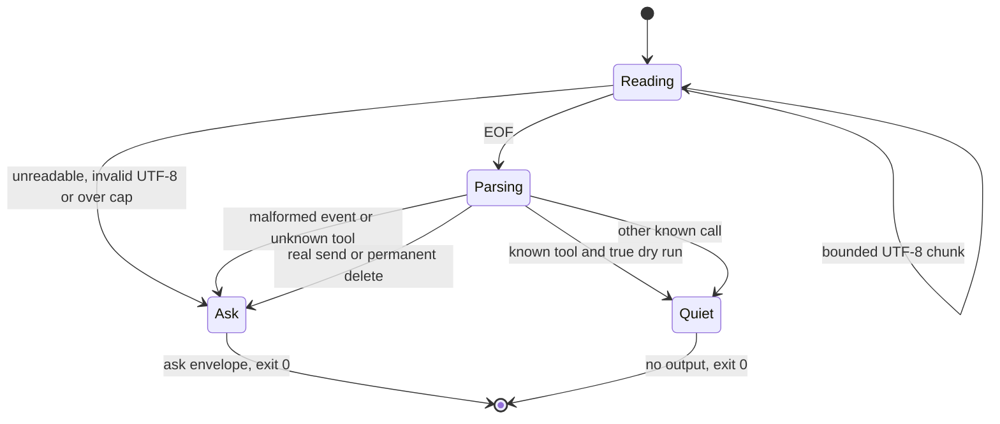

# Ask before sending or permanently deleting in Claude Code

Add a client-side prompt for MailBend's real sends and permanent deletes. The
hook does not execute a tool, grant permission, or attest human approval. The
`permanently-delete` confirmation word remains only a mistake guard.

## Add the hook

Build MailBend first. In your Claude Code settings, merge this hook into the
existing `hooks` object. Replace `/absolute/path/to/MailBend` with your checkout
path. If your MCP server has a different name, replace `mailbend` in the matcher.
Do not change your permission mode to use this hook.

```json
{
  "hooks": {
    "PreToolUse": [
      {
        "matcher": "^mcp__mailbend__.*$",
        "hooks": [
          {
            "type": "command",
            "command": "\"/absolute/path/to/MailBend/scripts/mailbend\" hook claude-pretooluse"
          }
        ]
      }
    ]
  }
}
```

Use the public launcher, not `mailbend-core`. After changing settings, check the
hook in Claude Code's `/hooks` menu. The matcher must cover all tools from this
MailBend server, including future tool names. Unknown tools ask conservatively.

Check the command without any mailbox or credentials:

```sh
printf '%s\n' '{"hook_event_name":"PreToolUse","tool_name":"mcp__mailbend__mail_send","tool_input":{"to":["recipient@example.test"],"subject":"Example"}}' |
  scripts/mailbend hook claude-pretooluse
```

The output contains `hookSpecificOutput.permissionDecision` set to `ask`. This
checks the command's output. It does not send mail or establish that your
client displayed a prompt. Verify the prompt with synthetic arguments and
cancel it before permitting any tool call.

## Decision contract

- `mail_send`, non-draft `mail_reply` and `mail_forward`, and `mail_delete` ask,
  unless `dry_run` is the JSON Boolean `true`.
- Draft replies and forwards, other known operations, and true dry runs exit 0
  without output. Silence leaves Claude Code's normal permission flow in place.
- A string such as `"dry_run": "true"` does not suppress a prompt.
- Unknown tools, invalid event shapes, malformed JSON, invalid UTF-8, input
  over 65,536 bytes, and read errors ask. The command still exits 0.
- The command never emits `allow`, `deny`, `updatedInput`, or tool arguments.

The event needs `hook_event_name: "PreToolUse"`, a string `tool_name`, and an
object `tool_input`. The operation name is the part after the last `__`, or
the whole name if there is no separator. The byte cap includes whitespace.
The command accepts a pipe or file and waits for EOF before deciding. There is
no new timeout; the producer must close its pipe. Socket stdin is unsupported
and produces `ask` through the public launcher.

The reason lists the tool, input `to`, `cc`, `bcc`, and subject, attachment
count, and effective `reply_all` value. Each recipient array has a count before
its details, including entries omitted from the summary. An absent array counts
as zero; a non-array value has an invalid count. These count supplied entries,
not validated addresses or the recipients inferred from an original message.
Each text field is limited to 160 Unicode characters. A shortened field ends
with ` [truncated]`, included in that limit. The complete reason is limited to
1,024 characters with the same marker if shortened, and
contains no control or Unicode format characters, including bidi controls.
Bodies, attachment paths, and unrelated event fields are omitted. The summary
can be incomplete after truncation; inspect the full arguments before acting.
For replies, the reason says recipients come from the original message and
points to `dry_run` to inspect the actual recipient list.

## Limits

This is an optional client-side prompt, not an enforced MailBend approval gate.
It does not replace `MAILBEND_READ_ONLY`, `MAILBEND_DRAFTS_ONLY`, the recipient
allowlist, Jev's vetoes, or the client's other permission rules. The hook reads
no credentials, starts no MailBend helper, and makes no network connection.
It does not apply to shell calls, other clients, or an unmatched MCP server.

Claude Code owns whether and where a prompt appears. Its
[hook reference](https://code.claude.com/docs/en/hooks#pretooluse-decision-control)
documents `ask` and decision precedence. Whether `ask` still prompts in
`bypassPermissions` mode has not been verified by MailBend. Do not rely on this
hook in that mode. A missing executable, timeout, disabled hook, or another
hook can also change the client outcome. The hook is an interim prompt while
[client-attested approval](https://github.com/albertc71/MailBend/issues/88)
remains undecided.

## Input lifecycle



The laws prove ask-or-none output, bind the printed string to its specified
ask envelope, and require prompts for non-dry-run sends and permanent deletes.
Further laws inspect parsed printed output for unparseable or oversized input,
unknown tools, and missing tool names. CLI tests exercise input framing, sanitization, byte caps,
and the no-helper boundary. The chart describes the adapter, not a verified
Claude Code runtime or a proof of human consent.
