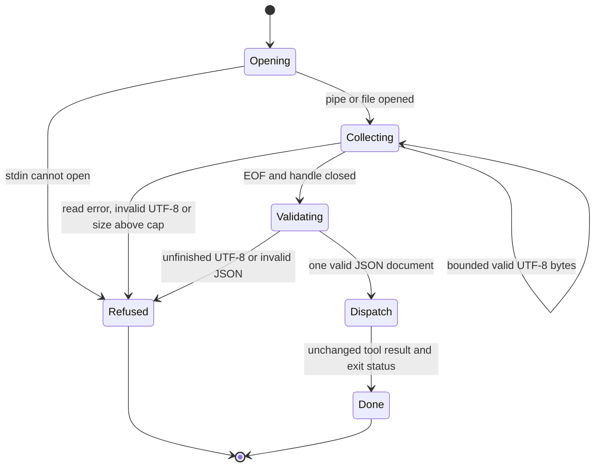

# CLI contract

Use the public `scripts/mailbend` launcher. The argv form remains supported:

```sh
scripts/mailbend call mail_search '{"from":"alice","limit":5}'
```

For long arguments or mail content that must not appear in the process argument
list, pass `-` as the JSON argument and provide one UTF-8 JSON document on stdin:

```sh
scripts/mailbend call mail_search - < arguments.json
printf '%s\n' '{"from":"alice","limit":5}' | scripts/mailbend call mail_search -
```

Stdin may be a pipe or regular file. The CLI waits for EOF before it runs any
tool. Multiline JSON and surrounding JSON whitespace are accepted. Empty input,
invalid UTF-8, malformed JSON, a second document and trailing non-whitespace are
refused. The complete input, including whitespace, must be at most 8 MiB
(8,388,608 bytes). Input over that cap is refused before tool dispatch. This is
the same byte limit as one MCP request line, but CLI input is one document,
not a stream of requests. There is no new input timeout; a producer must close
its pipe. A literal JSON string `"-"` remains an ordinary argv JSON argument.

Using stdin avoids putting the document in argv. It does not hide data from the
caller, privileged users or a file you create. Keep argument files private. Do
not put passwords in either JSON form; use the existing credential settings.

## Output and status

`call` prints one JSON tool result on stdout after dispatch, followed by a
newline. A failed or partial tool prints its JSON result and exits nonzero.
Argument or input errors print no tool result. Human diagnostics go to stderr.
`tools` and `diagnose` print JSON; `version` prints human-readable version text.
`mcp` uses its existing JSON-RPC stream and is not a one-result CLI command.

| Exit | Meaning |
| --- | --- |
| 0 | The command completed successfully. Inspect the JSON result where applicable. |
| 1 | A tool failed or returned a partial result. This does **not** mean that nothing changed. |
| 2 | Usage, JSON, UTF-8, stdin size/read/open error, or a launcher with no available core/runtime. |
| 6 | The core cannot open inherited socket stdin. For `call`, use a pipe or file. For MCP, use the public launcher. |

These are the existing success/tool/usage/socket classes; no exit 3 is added.
Signals and other process/runtime failures can produce other nonzero statuses.
Never retry a write just because its exit status is nonzero. In particular,
`partial: true`, SMTP `smtp_outcome: "unknown"`, or interruption without a final
result can mean that a change happened. Check the mailbox or delivery outcome
before retrying. The separate never-retry exit class proposed in #116 remains
undecided pending the #81 error taxonomy.

## Input lifecycle



This chart describes the CLI input adapter. It does not model the tool's mail
operations or prove the parser. Behavioral tests drive the actual launcher with
pipes, files, sockets, malformed inputs and the byte-cap boundaries.
