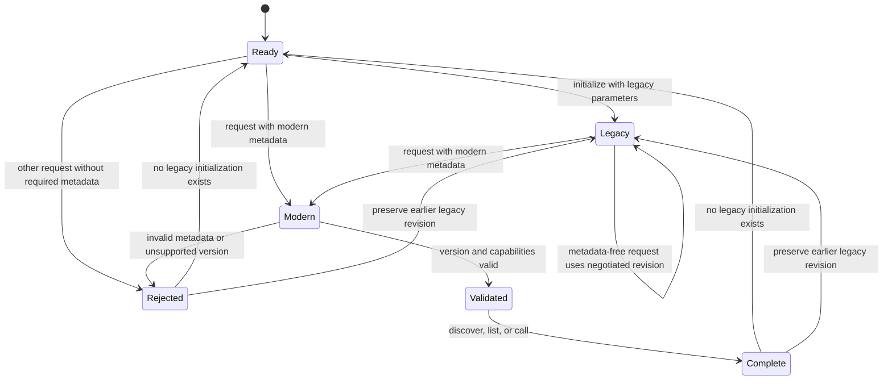

# MCP compatibility

MailBend serves newline-delimited JSON-RPC on stdio. It supports modern MCP
`2026-07-28`, plus initialization-based `2025-06-18`, `2025-03-26` and
`2024-11-05`. The CLI is independent of MCP negotiation.

Modern requests include `params._meta` with
`io.modelcontextprotocol/protocolVersion: "2026-07-28"` and
`io.modelcontextprotocol/clientCapabilities: {}`. Client identity is optional.
`server/discover` returns all supported versions, server identity, instructions
and the `tools` capability. Discovery is optional: a valid `tools/list` or
`tools/call` may be the first request. Every modern success carries
`resultType: "complete"` and server identity in `_meta`.

Legacy clients first send `initialize`; the returned revision applies to
subsequent requests without modern metadata in that process. An unsupported
legacy initialization version is offered `2025-06-18`. Modern requests can
interleave with that legacy session, but never inherit its version, identity or
capabilities and never change its negotiated revision. Before initialization,
a metadata-free tool request fails with invalid params. Legacy `ping` is also
allowed before initialization, but does not establish a legacy session.
Notifications cannot initialize a session. A modern marker with a missing or
malformed value cannot fall back to legacy handling.

Missing or malformed required modern metadata produces `-32602`. An unsupported
version string produces `-32022`, with `data.requested` and `data.supported`.
The older versions in that list require legacy initialization. Modern unknown
tools, malformed calls and invalid cursors produce `-32602`; unsupported methods
produce `-32601`. Valid tool calls that fail input validation, configuration,
safety checks or mail execution return `isError: true` in a complete tool result.
Partial mail changes retain their existing error payload and partial indication.
Malformed modern envelopes omit unreadable IDs even after legacy initialization.

The tool list is deterministic for the process configuration. It uses JSON
Schema 2020-12-compatible object input schemas and tool annotations. Results
contain JSON serialized in a text content block. Modern requests and negotiated
`2025-06-18` sessions also expose the identical `structuredContent` value and
per-tool output schemas; older sessions omit those fields.
Read-only, drafts-only and Jev settings determine availability through the same
code used by the CLI. Client capability claims cannot widen that availability.

MailBend provides no HTTP transport, MCP authorization, resource or prompt
capabilities, list-change notifications, subscriptions, logging notifications,
client sampling/elicitation, asynchronous tasks or resumable calls. Lists fit
in one response, so no cursor is issued and supplied cursors are rejected.
No cache lifetime is advertised. Modern `ping` and `initialize` are not methods
in this revision; legacy `ping` remains supported. Calls run serially. A queued
cancellation is consumed after the active call completes; there is no promise
of interrupting a mail operation already in progress. Notifications receive no
reply, and closing stdin exits after pending work.

## Conformance mapping

The fixed [2026-07-28 TypeScript schema](https://github.com/modelcontextprotocol/modelcontextprotocol/blob/271ecc9accafdd9b83a3c869fa67c22953b2af80/schema/2026-07-28/schema.ts)
and the linked normative pages are the authority. The names below identify
official schema examples or requirement sections, **not** a claim that an
external SDK or the complete upstream conformance runner was executed.
Target clients are generic stdio JSON-RPC clients using either documented era;
vendor application compatibility has not been separately exercised.

| Official contract / example | Local verification |
| --- | --- |
| [Discovery](https://modelcontextprotocol.io/specification/2026-07-28/server/discover): `DiscoverRequest`, `DiscoverResultResponse/discover-result-response.json` | `mcp_modern`: discovery identity, versions, tools-only capability and complete result |
| [Versioning](https://modelcontextprotocol.io/specification/2026-07-28/basic/versioning): unsupported version error and dual-era matrix | `mcp_modern`: unknown, empty and legacy modern-version strings; all three legacy initializations and interleaved modern calls |
| [Base protocol](https://modelcontextprotocol.io/specification/2026-07-28/basic/index): required metadata, result type and request ids | `tests/unit/mcp-protocol.bend`; `mcp_modern`: absent/null/scalar/object/array version values, capabilities, optional identity, null/fractional ids, integer-valued decimal/exponent ids and independent requests |
| [Tools](https://modelcontextprotocol.io/specification/2026-07-28/server/tools): `ListToolsRequest/list-tools-request.json`, `CallToolRequest/call-tool-request.json`, `CallToolResult/invalid-tool-input-error.json` | `mcp_modern`: real synthetic-mail search, schema-bearing list, input failure, malformed/unknown tool, safety switches, invalid cursor |
| [stdio](https://modelcontextprotocol.io/specification/2026-07-28/basic/transports/stdio): framing, notifications, shutdown | `mcp_framing` and `mcp_modern`: multibyte UTF-8, multiple lines per read, unfinished final line, blank lines, 8 MiB cap, notifications and clean EOF |
| [Legacy initialization](https://modelcontextprotocol.io/specification/2025-06-18/basic/lifecycle) | Existing `mcp`, `tests/unit/main.bend`, plus each supported legacy version in `mcp_modern` |

These MCP contracts are checked by unit and synthetic end-to-end tests. The
existing `LAWS.bend` / `PROOF.bend` proofs cover mail safety invariants; they do
not formally prove MCP interoperability, transport handling or metadata checks.
