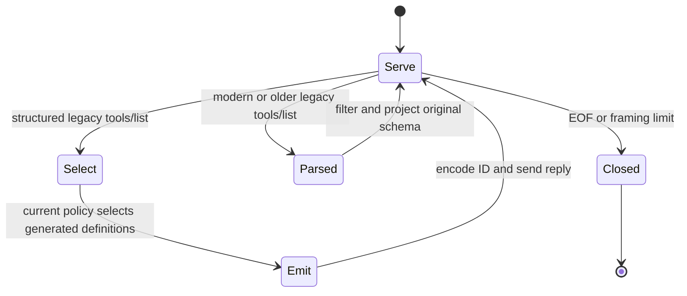
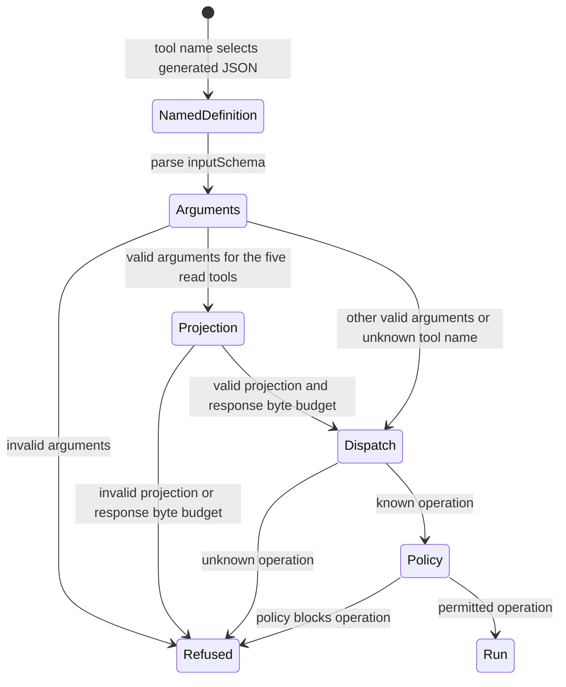
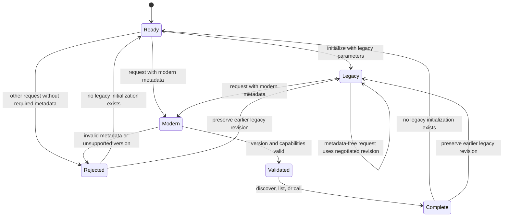

# MCP compatibility

MailBend serves newline-delimited JSON-RPC on stdio. It supports modern MCP
`2026-07-28`, plus initialization-based `2025-11-25`, `2025-06-18`, `2025-03-26` and
`2024-11-05`. The CLI is independent of MCP negotiation.

Register `scripts/mailbend mcp` (or `scripts/mailbend-cloud mcp` in cloud
environments), using its absolute path. These launchers support pipes, regular
files and inherited Unix stream sockets without a terminal. `mailbend-stdio` adapts
socket input to a pipe; Bend still owns JSON parsing, framing and limits.
Do not register `bin/mailbend-core` directly: the pinned Bend runtime reopens
`/dev/stdin`, which fails with `ENXIO` on socket-backed input.
That failure exits with code 6 and directs you to `scripts/mailbend mcp`.

Structured legacy `tools/list` replies select trusted generated JSON definitions
using the same current policy as the parsed listing path. Only generated schema
bytes enter that tools/list-specific envelope; request IDs are JSON-encoded.
No parsed schema or filtered response is retained between requests. Modern and
older legacy projections retain the original parsed-schema path. CLI listing
is unchanged. Tool-call validation parses only the named generated definition,
then applies the same input-schema and policy checks. Every known tool must
retain its original input schema; unknown names keep the unknown-tool refusal.

Tool-call schema selection follows the existing validation order. The extra
projection and response-byte-budget check applies to `mail_get`, `mail_search`,
`mail_get_new`, `mail_brief` and `mail_get_thread`:

Modern requests include `params._meta` with
`io.modelcontextprotocol/protocolVersion: "2026-07-28"` and
`io.modelcontextprotocol/clientCapabilities: {}`. Client identity is optional.
`server/discover` returns all supported versions, server identity, instructions
and the `tools` capability. Discovery is optional: a valid `tools/list` or
`tools/call` may be the first request. Every modern success carries
`resultType: "complete"` and server identity in `_meta`.

Legacy clients first send `initialize`; the returned revision applies to
subsequent requests without modern metadata in that process. An unsupported
legacy initialization version is offered `2025-11-25`. Modern requests can
interleave with that legacy session, but never inherit its version, identity or
capabilities and never change its negotiated revision. Before initialization,
a metadata-free tool request fails with invalid params. Legacy `ping` is also
allowed before initialization, but does not establish a legacy session.
Notifications cannot initialize a session. A modern marker with a missing or
malformed value cannot fall back to legacy handling.

Missing or malformed required modern metadata produces `-32602`. An unsupported
version string produces `-32022`, with `data.requested` and `data.supported`.
The older versions in that list require legacy initialization. Modern unknown
tools, malformed calls and invalid cursors produce `-32602`; unsupported methods
produce `-32601`. Valid tool calls that fail input validation, configuration,
safety checks or mail execution return `isError: true` in a complete tool result.
Partial mail changes retain their existing error payload and partial indication.
Malformed modern envelopes omit unreadable IDs even after legacy initialization.

The tool list is deterministic for the process configuration. It uses JSON
Schema 2020-12-compatible object input schemas and tool annotations. Results
contain JSON serialized in a text content block. Modern requests and negotiated
`2025-06-18` and `2025-11-25` sessions also expose the identical `structuredContent` value and
per-tool output schemas; older sessions omit those fields.
Read-only, drafts-only and Jev settings determine availability through the same
code used by the CLI. Client capability claims cannot widen that availability.
Modern `server/discover` and `tools/list` complete results advertise
`ttlMs: 300000` (five minutes) and `cacheScope: "private"`. Their contents are
fixed for the process configuration, and the private scope prevents sharing a
tool list that reveals those settings. Legacy results and tool-call results
carry no cache hints.

MailBend provides no HTTP transport, MCP authorization, resource or prompt
capabilities, list-change notifications, subscriptions, logging notifications,
client sampling/elicitation, asynchronous tasks or resumable calls. Lists fit
in one response, so no cursor is issued and supplied cursors are rejected.
Modern `ping` and `initialize` are not methods
in this revision; legacy `ping` remains supported. Calls run serially. A queued
cancellation is consumed after the active call completes; there is no promise
of interrupting a mail operation already in progress. Notifications receive no
reply, and closing stdin exits after pending work.

## Client prompts and tool annotations

Every tool has a human-readable title and explicit boolean MCP annotations.
All tools have `openWorldHint: true` because they interact with an external
mailbox or mail service. This also covers sender-controlled content in read
results, whether Jev is on or off. It does not mean every call contacts TypeSafe.

`readOnlyHint` follows MailBend's operation policy. `destructiveHint` means a
non-additive change: flag changes, moves, labels, Trash, permanent deletion,
folder renames and Jev triage. Sends, replies, forwards, new drafts, new folders
and new attachment files are additive, so their destructive hint is false.
This hint is not an assessment of an operation's overall risk. MailBend's
permanent-delete classifier, hook and safety gates are unchanged.

The tool definitions for `mail_send`, `mail_reply`, `mail_forward` and
`mail_delete` always include `_meta["anthropic/requiresUserInteraction"]: true`.
The flag is static: it also covers `dry_run: true` and `as_draft: true` calls.
Use `mail_save_draft` when an unattended workflow only needs a draft.

[Claude Code documents](https://code.claude.com/docs/en/mcp#require-approval-for-a-specific-tool)
that this flag prompts on each call, including in `bypassPermissions`, and
prevents allow rules from skipping the prompt. In `dontAsk` mode the call is
denied instead. Its non-interactive `--permission-prompt-tool` cannot approve a
flagged tool. The Agent SDK's `canUseTool` callback can approve it, so the SDK
application must show the request to a person.

These are client-side behaviors, not proven human approval. MailBend cannot
attest who answered a client prompt, and other clients may ignore the metadata.
The CLI does not read this MCP metadata. The `permanently-delete` confirmation
word remains a mistake guard, not approval. The argument-sensitive
[Claude Code hook](CLAUDE-HOOK.md) remains available, but it cannot remove the
static metadata prompt for a draft or dry run. Vendor client UIs have not been
tested as part of this metadata change.

Server discovery, initialization and modern tool listings include a title,
a description and the project's website URL. All legacy initializations also
include this rich server identity, and tool listings for every supported
revision include tool titles and `_meta`. Some of these fields are extensions
to older revision schemas; clients must tolerate unknown fields. Compatibility
of the existing result shapes covers `tools/call` results and the omission of
`outputSchema` from `tools/list` before `2025-06-18`. It does not cover the other
`initialize` or `tools/list` metadata. Ordinary tool results retain the
compact server name and version, so display metadata does not inflate every
reply or its byte budget. Icons and a larger
`anthropic/maxResultSizeChars` are not advertised. Existing response budgets
remain in force.

## Conformance mapping

The fixed [2026-07-28 TypeScript schema](https://github.com/modelcontextprotocol/modelcontextprotocol/blob/271ecc9accafdd9b83a3c869fa67c22953b2af80/schema/2026-07-28/schema.ts)
and the linked normative pages are the authority. The names below identify
official schema examples or requirement sections, **not** a claim that an
external SDK or the complete upstream conformance runner was executed.
Target clients are generic stdio JSON-RPC clients using either documented era;
vendor application compatibility has not been separately exercised.

| Official contract / example | Local verification |
| --- | --- |
| [Discovery](https://modelcontextprotocol.io/specification/2026-07-28/server/discover): `DiscoverRequest`, `DiscoverResultResponse/discover-result-response.json` | `mcp_modern`: discovery identity, versions, tools-only capability and complete result |
| [Caching](https://modelcontextprotocol.io/specification/2026-07-28/server/utilities/caching): complete cacheable results | `tests/unit/mcp-protocol.bend`; `mcp_modern`: private five-minute hints on discovery and lists across read-only, drafts-only and Jev settings; no hints on legacy results or calls |
| [Versioning](https://modelcontextprotocol.io/specification/2026-07-28/basic/versioning): unsupported version error and dual-era matrix | `mcp_modern`: unknown, empty and legacy modern-version strings; all four legacy initializations and interleaved modern calls |
| [Base protocol](https://modelcontextprotocol.io/specification/2026-07-28/basic/index): required metadata, result type and request ids | `tests/unit/mcp-protocol.bend`; `mcp_modern`: absent/null/scalar/object/array version values, capabilities, optional identity, null/fractional ids, integer-valued decimal/exponent ids and independent requests |
| [Tools](https://modelcontextprotocol.io/specification/2026-07-28/server/tools): `ListToolsRequest/list-tools-request.json`, `CallToolRequest/call-tool-request.json`, `CallToolResult/invalid-tool-input-error.json` | `mcp_modern`: real synthetic-mail search, schema-bearing list, input failure, malformed/unknown tool, safety switches, invalid cursor |
| [stdio](https://modelcontextprotocol.io/specification/2026-07-28/basic/transports/stdio): framing, notifications, shutdown | `mcp_framing` and `mcp_modern`: multibyte UTF-8, multiple lines per read, unfinished final line, blank lines, 8 MiB cap, notifications and clean EOF |
| [Legacy initialization](https://modelcontextprotocol.io/specification/2025-06-18/basic/lifecycle) | Existing `mcp`, `tests/unit/main.bend`, plus each supported legacy version in `mcp_modern` |

These MCP contracts are checked by unit and synthetic end-to-end tests. The
existing `LAWS.bend` / `PROOF.bend` proofs cover mail safety invariants; they do
not formally prove MCP interoperability, transport handling or metadata checks.

## Message metadata

`mail_search`, `mail_get_new`, `mail_get_thread`, and whole-message `mail_get`
return the same metadata fields. Selected MIME-part reads keep their separate
contract. Whole-message reads fetch the selected headers separately from the
bounded body prefix, so `max_bytes` does not cut these fields.

`list_id` and `auto_submitted` contain the first unfolded header value, or null
when absent or empty. The values are untrusted and are not decoded as display names.
`bulk` uses the first matching rule below. A missing signal produces null.

1. A nonempty List-ID produces `list`.
2. A valid Auto-Submitted token other than `no` produces `auto`. Comments and
   optional parameters do not turn `no` into an automatic message.
3. Precedence `bulk`, `list`, or `junk` produces `precedence-bulk`.

`unsubscribe` contains nullable `mailto` and `https` strings, plus `one_click`.
The strings are the first bracketed URI of each scheme in header order. The
parser ignores bracket-internal whitespace and stops after malformed items.
It does not open links, send mail, or unsubscribe.

`one_click` is an unverified advertised signal. It requires exactly one HTTPS scheme item with a nonempty host,
no userinfo in its authority, no HTTP item or malformed list suffix,
one List-Unsubscribe header, and one
List-Unsubscribe-Post header whose value
is `List-Unsubscribe=One-Click`. It is not a complete URI validator, does not verify DKIM, and does not grant
permission to use the endpoint. A URI with userinfo remains visible in `https`,
but cannot set `one_click`. These fields cannot establish that a sender or link is safe.
See [RFC 2369](https://www.rfc-editor.org/rfc/rfc2369.html) and
[RFC 8058](https://www.rfc-editor.org/rfc/rfc8058.html).

`answered` reflects `\Answered` and `forwarded` reflects `$Forwarded`, with
case-insensitive flag comparisons. All metadata survives body projection and
uses the existing response byte budget. An insufficient budget returns an
error rather than dropping metadata or advancing an arrival checkpoint.
