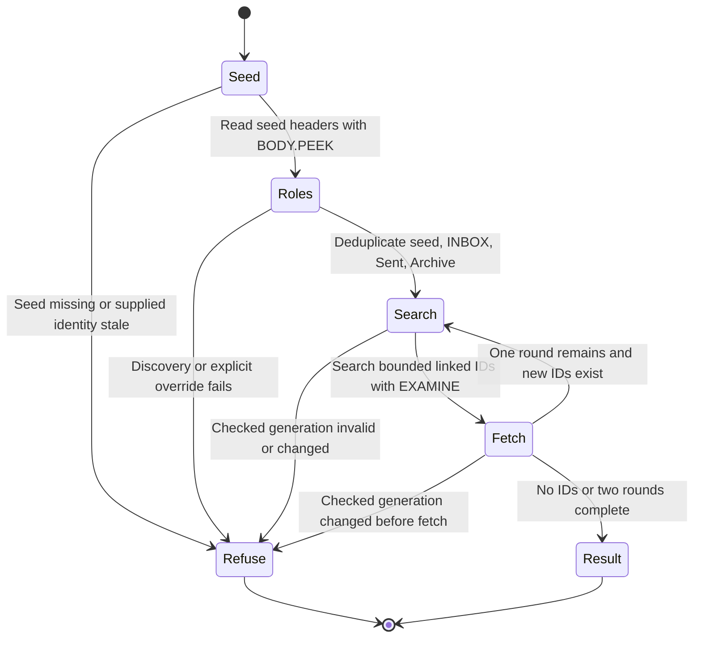

# Thread reads

`mail_get_thread` links messages by Message-ID, In-Reply-To and References,
never by subject. It searches the seed's folder, INBOX, resolved Sent and
resolved Archive, in that order, with duplicate folders removed. INBOX aliases
are case-insensitive; other mailbox names keep their existing comparison rules.
An absent or ambiguous Archive role adds no folder. `\All` is not automatically
Archive; an explicit selectable `MAILBEND_ARCHIVE_FOLDER` override still works.

The existing bounds remain two rounds and at most 50 linked IDs per round.
Adding Archive can find more of a conversation within those rounds; it does not
promise the full history. Results retain INTERNALDATE/UID ordering and per-message
folder, UIDVALIDITY and parent fields. Jev annotation policy is unchanged.

This diagram describes the existing read flow with Archive added to its folder
list. It is design guidance, not an executable model or a new proof.

All read plans use EXAMINE and BODY.PEEK, never SELECT or flag writes. The
existing `thread_plans_write_nothing` law covers arbitrary folder lists, including
Archive. Supplied seed UIDVALIDITY enables the existing per-folder identity checks
across later sessions; it does not apply the seed's identity to another folder.
See [the laws](../LAWS.bend) and [read configuration](../README.md#configure).

This implements only the thread-read part of issue #67. Destination UID reporting,
archive/write tools and Gmail move semantics are outside this change.
