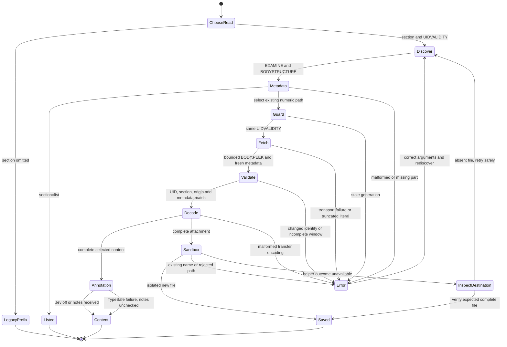

# Selected MIME parts (#23)

Outcome: retrieve a selected text, HTML or attachment part without fetching
unrelated oversized MIME payloads. Keep selection, decoding and plans in Bend;
keep TLS framing and sandboxed file publication in the existing native helpers.

## Contract

- Legacy whole-message prefix and attachment-index paths remain available.
- Explicit `section` reads require folder/UID/UIDVALIDITY identity, discover
  BODYSTRUCTURE, then EXAMINE and guard UIDVALIDITY before fetching a bounded
  BODY.PEEK section. Recheck the selected metadata in that response.
- Section identifiers are generated numeric paths, never interpolated input.
- Return complete decoded content or an explicit error. A selected download
  must fit the existing encoded window and complete strict transfer decoding.
- Existing sandbox, no-overwrite, read-only and dry-run behavior remain in force.
- Selected content preserves configured Jev annotations. Parent headers and only
  selected readable text enter the existing pipeline; text and result scope
  explicitly mark the overall message incomplete. Binary bytes do not enter Jev.
- `message/rfc822` is an opaque attachment; nested multipart paths are supported.

## Validation status

- Final `bend PROOF.bend --verdict`: ALL PROOFS CHECK. The universally
  quantified read-plan laws cover metadata discovery, selected reads and the
  exact guarded plan. The exhaustive PEEK rendering law covers numeric section
  items, and PROOF imports the new sections module for kernel rechecking.
- The isolated negative control replaces `CExamine` with `CSelect` only in
  `plan_part`. The same verdict command fails `Laws.part_writes_nothing`
  (expected `True{}`, observed `False{}`); production laws are unchanged.
- Unit tests: 14/14 passed. Transport: 23/23 passed. Cloud network: 14/14 passed.
- Python fixture/schema syntax compilation passed. Both new section unit files
  pass, including stale UIDVALIDITY/UID, changed metadata, unexpected partial
  origin and incomplete literals.
- Secret scan passed the working tree and all 184 commits with no findings.
  The copied negative-proof source was moved outside the worktree because its
  existing secret-detector test string is allowlisted only at the original path.
- Native build passed after shared WSL recovery. Targeted synthetic TLS and
  sandbox cases passed 28/28 using the native Linux `/tmp` filesystem. The
  initial Windows-mounted test directory correctly failed the O_TMPFILE
  requirement; the optional test-directory override leaves sandbox rules intact.
- Full end-to-end and native checks, final CI and independent review are in progress.
- Readability review simplified discovery validation, documented generated-path
  matching, and replaced a generic transport test name to avoid integration
  collisions. The common whole-message annotation policy is retained for
  selected content, with headers/body/failure scenarios covered.
- Initial local unit comparisons exposed checkout CRLF endings; normalizing
  local unit source files to LF restored the intended byte-exact comparisons.
  Assertions and expected values were not weakened.

## Synthetic comparison

The end-to-end fixture places a 26 MiB attachment before a nested text/HTML
alternative and a five-byte attachment. The selected encoded payloads are 12,
16 and 8 bytes. `MAILBEND_MEASURE_PARTS=1 python3 tests/test-e2e.py` also measures
whole-prefix and selected-text peak process RSS with GNU time. One local run
of the compiled CLI on the same fixture measured:

| Read | Message payload bytes received | Peak RSS (KiB) |
| --- | ---: | ---: |
| Legacy whole-message prefix | 262,144 | 29,524 |
| Selected text | 12 | 7,680 |

The fake TLS server records actual returned literal payload lengths; these
counts exclude protocol metadata. GNU time reports command peak RSS, excluding
the independently running fake server. This is a synthetic comparison of the
same compiled program, not a claim about every provider or workload. Selected
HTML returned 16 encoded bytes and the selected five-byte binary attachment
returned eight base64 bytes, without reading the 27,262,976-byte sibling.

## Failure and recovery flow

