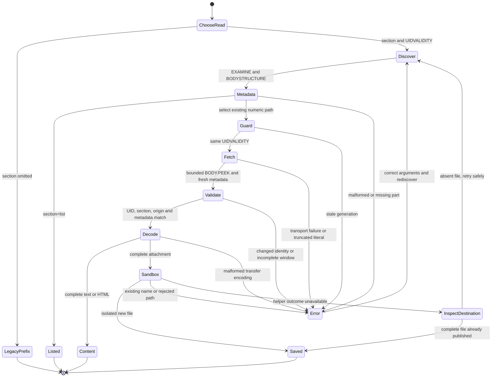

# Selected MIME parts (#23)

Outcome: retrieve a selected text, HTML or attachment part without fetching
unrelated oversized MIME payloads. Keep selection, decoding and plans in Bend;
keep TLS framing and sandboxed file publication in the existing native helpers.

## Contract

- Legacy whole-message prefix and attachment-index paths remain available.
- Explicit `section` reads require folder/UID/UIDVALIDITY identity, discover
  BODYSTRUCTURE, then EXAMINE and guard UIDVALIDITY before fetching a bounded
  BODY.PEEK section. Recheck the selected metadata in that response.
- Section identifiers are generated numeric paths, never interpolated input.
- Return complete decoded content or an explicit error. A selected download
  must fit the existing encoded window and complete strict transfer decoding.
- Existing sandbox, no-overwrite, read-only and dry-run behavior remain in force.
- `message/rfc822` is an opaque attachment; nested multipart paths are supported.

## Validation status

- Initial `bend PROOF.bend --verdict`: ALL PROOFS CHECK. The new universally
  quantified read-plan laws cover metadata discovery and selected reads; the
  existing exhaustive PEEK rendering law now covers numeric section items.
- Focused initial section parser/decoder unit run passed.
- Python fixture/schema syntax compilation passed. Both new section unit files
  pass, including stale UIDVALIDITY/UID, changed metadata, unexpected partial
  origin and incomplete literals.
- Secret scan passed the working tree and all 155 commits with no findings.
  The copied negative-proof source was moved outside the worktree because its
  existing secret-detector test string is allowlisted only at the original path.
- Full contributor checks, synthetic peak RSS measurement and final proof rerun
  await shared WSL recovery after two native builds exited without diagnostics.
- Negative proof control and independent review pending.

## Synthetic comparison

The end-to-end fixture places a 26 MiB attachment before a nested text/HTML
alternative and a five-byte attachment. The selected encoded payloads are 12,
16 and 8 bytes. `MAILBEND_MEASURE_PARTS=1 python3 tests/test-e2e.py` also measures
whole-prefix and selected-text peak process RSS with GNU time. Report actual
measurements only after this run succeeds.

## Failure and recovery flow

