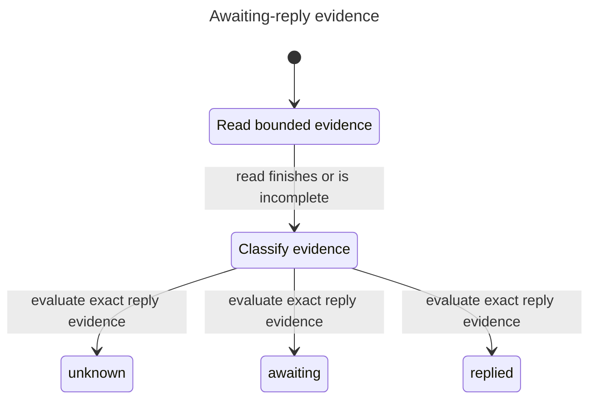

# Awaiting replies

`mail_awaiting_reply` answers which sampled Sent messages have no exact reply
in INBOX or the uniquely resolved Archive. It does not infer intent, follow
subjects, modify flags, create drafts, send mail, or call Jev.

## Contract

The tool captures one clock value. `window_days` defaults to 30 and is bounded
at 3650. `min_age_days` defaults to 3 and cannot exceed the window. `limit`
defaults to 50 and cannot exceed 50. Invalid bounds or clock reads fail.

SENTSINCE selects using the message Date header. Age and reply ordering use
INTERNALDATE. Those are different clocks. Candidates are the lowest UIDs in
the window, at most the limit, then ordered by INTERNALDATE and UID. The order
is oldest-first within that sample, not globally oldest-first when capped.

Replies must name one complete Message-ID token in In-Reply-To or References
and have a valid strictly later INTERNALDATE. A subject match or substring
match is not a reply. Sent candidates dated after the captured clock are excluded.
Future-dated reply evidence makes coverage incomplete, so absence stays unknown.
This is not an atomic mailbox snapshot; rerun after concurrent changes.

The response includes `complete`, a reason, searched folders, whether Archive
resolved, the captured clock, and candidate messages. Each message includes
`awaiting`, `replied`, or `unknown`, age, To/Cc header text and a thread anchor.
Bcc is not fetched. Missing recipients are empty strings, not invented values.
Unresolved Archive is explicitly reported and is outside the searched scope.
Replied means a later exact reference, not a verified human or recipient answer.
Self-follow-ups, auto-replies and bounces can qualify. Self, list, automatic-message
and bounce exclusions remain follow-up work in #63.

## Coverage and bounds

Every search must have a tagged OK and exactly one valid SEARCH record.
Unsolicited unrelated responses do not establish or invalidate SEARCH results.
Malformed or duplicate SEARCH records, missing identities, changed UIDVALIDITY,
transport failures and missing requested header data make coverage incomplete.

Searches batch at most ten candidate IDs, each with References and In-Reply-To
alternatives. Reply fetches are capped at 100 headers per folder, 200 total.
Each helper response is capped at 256 KiB and 30 seconds. Candidate truncation
also sets `complete:false`, but does not change a fully read candidate's status.
A valid sampled candidate can be `awaiting` when reply-side coverage is complete,
even if another candidate is invalid or the Sent sample is capped. Missing or
multiple Message-IDs and invalid candidate dates make only that candidate unknown.
Missing, capped or malformed reply evidence keeps absence unknown conservatively
for all sampled candidates. Exact valid positive evidence remains `replied`.
Each SEARCH record accepts at most 10,000 UIDs; larger records report incomplete
coverage rather than truncating validation or confirming absence.

## Statechart



The model separates Sent-sample coverage from reply-side coverage. Its `replyComplete`
variable represents reply-side evidence only, not the top-level result field.
The bounded evidence model checks 33 states and 48 steps. NoFalseAbsence,
PositiveNeedsIdentity and NoDeadlock hold. The chart hides sixteen terminal
self-loops that leave the reader-visible state unchanged. This model abstracts
SEARCH, FETCH, parsing, mailbox races and TLS; it does not prove the code.
Read-plan laws cover command constructors, and fake-server tests cover evidence.

The negative control allows incomplete evidence to become `awaiting`. It breaks
NoFalseAbsence on the two-step path Read → Classify → awaiting. The unit test
with a valid candidate, no replies and incomplete coverage rejects that path
in the real reducer.

Reproduce with the pstack statechart command from commit
`5851c89613e2ddc3a6b7f4af02a42363b30ef8d3`, from a scratch directory:

```sh
statechart /path/to/MailBend/docs/plans/awaiting-reply-model/Awaiting.tla \
  --config /path/to/MailBend/docs/plans/awaiting-reply-model/Awaiting.cfg \
  --view /path/to/MailBend/docs/plans/awaiting-reply-model/view.ts --out baseline
```

Use `Broken.cfg` and a different output directory for the negative control;
that run must report the NoFalseAbsence violation.

## Review order

1. Read `src/awaiting.bend` for exact matching and evidence validity.
2. Read the awaiting helpers in `src/tools.bend` for bounded sessions and UID checks.
3. Review `src/ops.bend`, `LAWS.bend` and `PROOF.bend` for read-only plans.
4. Review fake-server and unit tests, then the schema source. The generated
   `src/schema.bend` and tool-list expectations are mechanical changes.

Scheduling, weekends and draft wording belong to the calling agent. The
follow-up-drafts recipe remains unchanged until integration tests verify the
new tool contract. It never grants permission to send a message.
