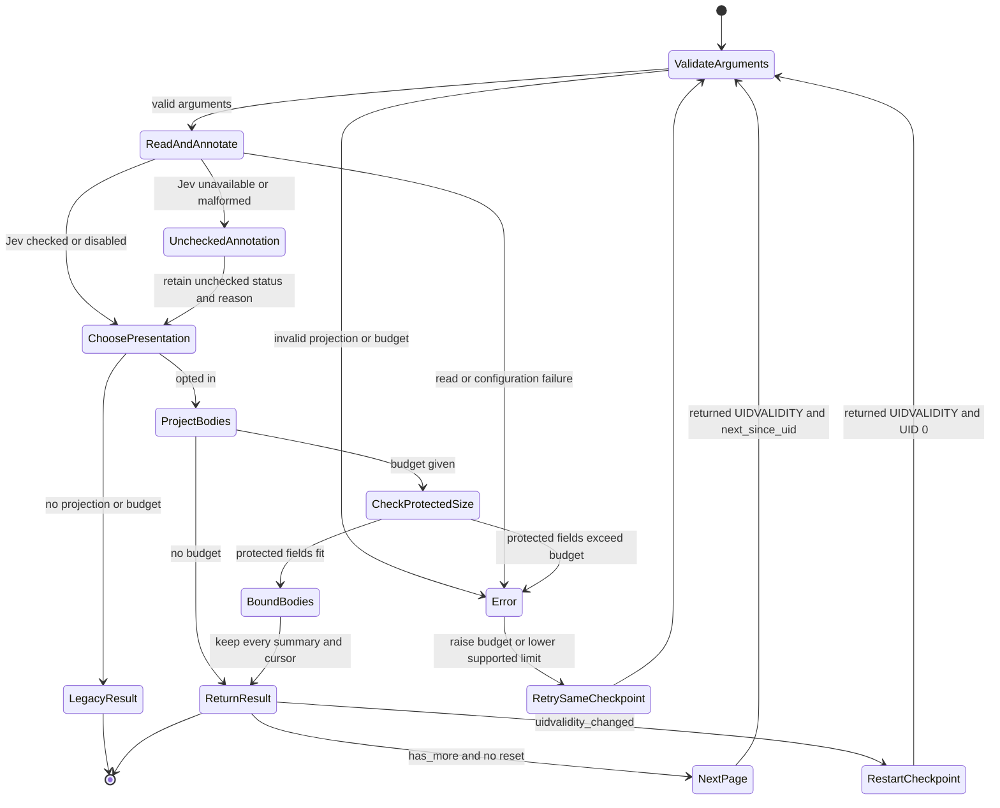

# Bounded read responses

Outcome: explicit full/text/html/metadata body selection and an optional UTF-8
result JSON budget on the four annotated read tools. Defaults remain byte-for-byte
compatible. All selected summaries, identity, completeness, errors, Jev and cursor
state survive; impossible budgets fail with retry guidance. No native or protocol
changes, selective MIME fetch, history heuristics, or arbitrary field scripts.

Implementation: project once after annotation, count escaped JSON bytes before
serialization, reserve immutable fields and notice, and allocate the remaining
bytes to text then HTML without splitting Unicode scalars. Errors are outside the
budget. CLI newline and MCP envelope/escaping/structured-content duplication are
outside the shared result budget.

Acceptance: unit byte-boundary/schema tests; synthetic plain/HTML/multipart/history/
multibyte CLI and MCP tests; cross-page cursor retry tests; unchanged Jev input;
response-byte and character measurements without token-saving claims; full
contributor checks and independent review before the draft PR.

Status: implementation, 13 focused checks, 86 synthetic projection checks,
rebuilt helpers/core and `bend PROOF.bend --verdict` pass. Full contributor
checks are in progress after recovery from concurrent-build OOM. The focused cases cover exact escaped UTF-8 size, default compatibility,
field selection, tiny-budget rejection, scalar boundaries and protected fields.

## Verification scope

Existing safety laws remain unchanged. Three added laws prove generic non-body
field selection, fix the body classifier to exactly text/HTML, and preserve every
non-body JSON value and byte allowance while fitting. The new whole-response
budget and cursor invariants are validated by unit and synthetic e2e tests;
this work does not claim a universally quantified byte-budget or IO theorem.
The parent coordinates the requested independent formal-verification council and
simplification review. An extra simplifier spawn was unavailable at the shared
agent limit; no review completion is claimed here.

## User flow

## Maintainer audit

Bend-specific review: `bend guide` was read; definitions precede use; matches
inspect parameters; prefix recursion occurs exactly once, with eager `Bool.pick`
used only for values; source lines fit 100 columns. Projection occurs after
annotation and never descends into Jev answers, messages, attachments or cursor
metadata. Native mail policy, EXAMINE/BODY.PEEK plans and helper source are unchanged.

The parent-requested shared webpki lockfile fix is included as a separate commit;
final helper builds must use that updated lockfile. CI must be green for the final
SHA before readiness, and this branch remains a draft with no merge.

## Session journal

The initial focused checks found that the shared schema validator enforces types,
not enum or range constraints. The new arguments now get explicit enum and bounded
integer validation before dispatch; zero, negative, overflow and unknown projection
values fail without connecting. This preserves existing validation for other tools.
Windows checkout CRLF endings also required local normalization for shell scripts
and expected-output unit fixtures; those normalization-only changes are excluded
from the feature commit. Local journal evidence stays here to honor the requested
`docs/plans` location. AgentWiki publish skipped.

## Synthetic response measurements

The checked-in fixtures repeat quoted history with accented, Japanese and emoji
characters 100 times, encoded as plain mail, HTML-only mail and multipart mail.
The table records tool-result UTF-8 bytes and characters (the text supplied to an
agent), plus measured MCP wire bytes including its final newline. No tokenizer was
run, so these are not token counts or token-saving claims. The opt-in cap is 1200
result bytes; MCP's escaping/envelope is intentionally outside that cap.

| Fixture | Projection | Result bytes | Result characters | MCP wire bytes |
| --- | --- | ---: | ---: | ---: |
| Plain | Default | 6122 | 5322 | Not measured |
| Plain | Full | 1199 | 1111 | 1461 |
| Plain | Text | 1199 | 1111 | 1458 |
| Plain | HTML | 577 | 577 | 749 |
| Plain | Metadata | 571 | 571 | 739 |
| HTML-only | Default | 11975 | 10375 | Not measured |
| HTML-only | Full | 1199 | 1111 | 1461 |
| HTML-only | Text | 1199 | 1111 | 1458 |
| HTML-only | HTML | 1199 | 1111 | 1458 |
| HTML-only | Metadata | 570 | 570 | 738 |
| Multipart | Default | 11969 | 10369 | Not measured |
| Multipart | Full | 1199 | 1111 | 1461 |
| Multipart | Text | 1199 | 1111 | 1458 |
| Multipart | HTML | 1198 | 1110 | 1456 |
| Multipart | Metadata | 571 | 571 | 739 |

These are synthetic cases, not production savings. The response notice can make
small opt-in results larger than the unchanged default. One byte is reserved for
the longer `false` truncation flag; a cut result may therefore leave a byte unused.

## Proof mutation evidence

The Opus laws review requested direct protection beyond comments. Three generic
laws were added, and ordinary `bend PROOF.bend` reports `ALL PROOFS CHECK`.
Two temporary mutations of the real `src/response.bend` were each rejected with
`SOME PROOFS FAIL`: adding a `key != "jev"` guard to `keep`, and adding `"jev"`
to `body_key`. The first fails `projection_keeps_nonbody`; the second fails
`response_body_fields_are_exact`, preventing the generic non-body premise from
becoming vacuous. The source was restored byte-for-byte after both checks, and
the restored proofs pass. Final proven-kernel verification is queued.
