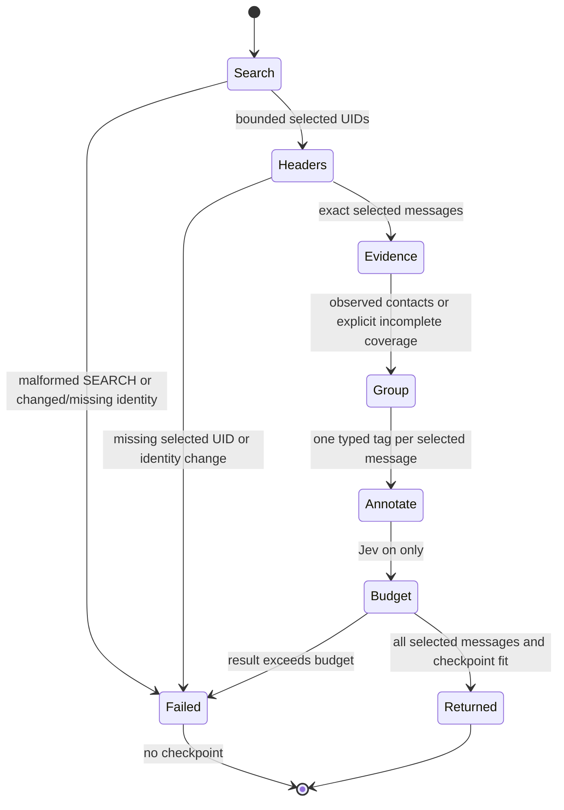
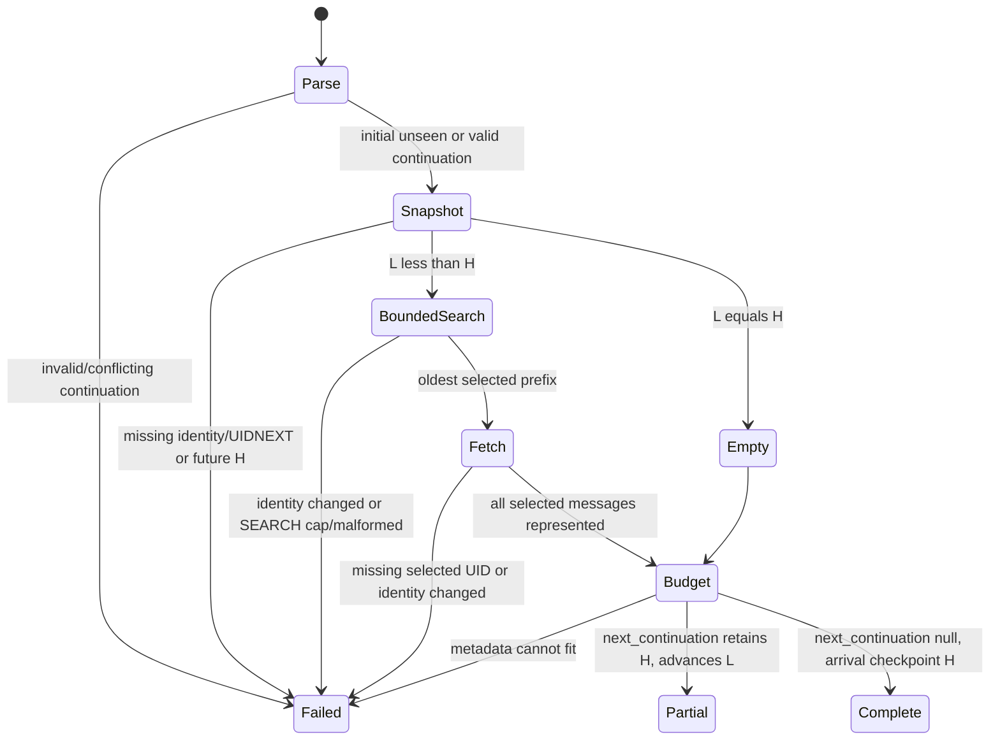

# Deterministic metadata attention brief

Issue #61 asks for a bounded daily attention view without per-message reads.
The existing summaries already expose bulk metadata. This slice groups those
summaries, with a bounded stored-Sent observation and an arrival checkpoint.
It does not claim that metadata determines urgency or that an unseen sender is
new to the user.

## Design choice

| Alternative | Result |
| --- | --- |
| Reuse `mail_get_new` and regroup its JSON | Rejected. A brief needs an explicit selected-versus-fetched completeness gate and unseen acquisition. |
| Per-sender whole-Sent candidate lookup | Rejected for this read. Up to 100 sequential sessions is excessive for a daily metadata view; complete stored headers still cannot prove lifetime absence. |
| One bounded Sent window and typed tagged items | Chosen. Positive exact matches are useful while absent or partial observations stay unknown. No cache or new native contract. |
| Remove nested items to fit the response budget | Rejected. The existing all-or-error metadata budget preserves all identities and the checkpoint together. |

The production `Brief.Item` holds one original message, one primary `Group`,
one orthogonal `Delivery`, and a raw List-Id key. Its typed tag is the partition.
The JSON `messages` array is UID ordered and carries the same tags. `groups`
contains only derived counts, not a second copy of message payloads. List and
automation signals take priority over a known correspondent; direct delivery
never changes the primary group. Duplicate classification headers do not count
as a bulk signal. An incomplete header block or over-4096-byte relevant classification fields
produces unknown classification. Only From, To, Cc, List-Id, Auto-Submitted and
Precedence consume that bound; duplicates are preserved in shared evidence. Unusable sender or recipient syntax makes only that address
evidence unknown. A single nonempty raw List-Id is an untrusted list signal,
not strict RFC validation or proof of list membership.

## Statechart

An empty page skips Sent lookup. Malformed From does not suppress independent
To/Cc evidence. Arrival mode returns the last selected UID (or its input on an empty page).
Unseen mode validates the same EXAMINE UIDNEXT, then excludes SEARCH UIDs above
UIDNEXT minus one. A complete page checkpoints that high-water UID, including
an empty page. A capped page checkpoints only the selected prefix, not the
high-water UID. `checkpoint_basis` exposes this distinction. Continuing a partial
prefix as arrivals can include older seen messages; it cannot skip omitted unseen
messages. Neither mode follows future unread-state changes.
No success path omits selected messages. Header fetching pins UIDVALIDITY in the
same session, and then verifies the complete selected UID sequence.

## Evidence and limits

- At most 100 selected messages, default 50. SEARCH above 10000 UIDs fails closed.
  Structured unseen continuation retains UNSEEN/UNDELETED and finite UID bounds,
  fixing seen-mail amplification. More than10000 matching unseen UIDs remains
  unsupported. Legacy since_uid still changes to all arrivals and can exceed the
  cap on large folders. `start=now` discards backlog, not recovers it.
- Unseen mode excludes `\Deleted` UIDs; a complete high-water checkpoint passes
  those UIDs even if later undeleted. Arrivals have no `UNDELETED` filter. Neither
  mode follows subsequent flag changes.
- Explicit empty selected headers use the shared acquisition helper; persistent
  NIL, absent or wrong sections fail closed without a checkpoint.
- At most 50 distinct selected sender addresses matched.
- One Sent search over 30 days and at most 100 newest candidate headers.
- No body fetch for the deterministic brief. No preview, cache or native change.
- No negative lifetime claim. Exact positive observations survive partial scans.
- The existing response projector preserves metadata or returns an error.
- Mail, metadata and model annotations remain untrusted and cannot authorize writes.

The laws [brief_preserves_selected_uids](../../LAWS.bend) and
[brief_partitions_selected_uids](../../LAWS.bend) prove ordered UID identity and
per-UID multiplicity for the actual production classifier. The tagged type gives
one primary group per occurrence. Runtime acquisition deduplicates requested
UIDs and requires an exact FETCH match before classification. The law
[brief_plans_write_nothing](../../LAWS.bend) covers the new acquisition plan;
existing contact and header-plan laws cover reused reads.

`brief-model/Brief.tla` is a bounded design model, not a CI-enforced or runtime
proof. It checks that failed acquisition or budget admission cannot publish a
checkpoint, each selected UID has one group, and a people tag requires observed
positive evidence. The negative switches deliberately break those invariants.

## Review and verification

Read `src/brief.bend`, the isolated brief block in `src/tools.bend`, the schema
source, then the laws and tests. `src/schema.bend` is generated and its literal
pool changes extensively when a tool is added. Check regeneration and the exact
schema pin instead of reviewing its pooled fragment numbering by hand.

`tests/brief-cases.py` runs through both canonical CLI and structured MCP suites.
It checks exact UID coverage, group counts, direct/Cc delivery, empty and resumed
checkpoints, response-budget retries, missing FETCH, UIDVALIDITY races, partial
contact evidence, sender caps, no mailbox changes and Jev-off operation. Its
separate metadata attention task uses #133's synthetic corpus and measures at
most two tool calls. It preserves the original persona tasks and goldens. This
is not a before/after speedup or a substitute for #139's agent-quality suite.

## Remaining #61 scope

Keep #61 open for optional preview extraction and its `preview_partial` and
estimated token fields, plus the separately authorized #139 quality evaluation.
Lifetime first-time classification needs a distinct evidence contract; stored
Sent windows cannot supply it. No paid service or real mailbox was used here.

## Review follow-up: snapshot checkpoints

The separate [checkpoint model](brief-model/Checkpoint.tla) is **design-time only**,
not run by CI and not linked to production code by an automatic drift check. It explores arbitrary
unseen subsets, EXAMINE high-water marks and oldest selected prefixes. It checks
that no omitted eligible UID is at or below the returned cursor, complete pages
use the snapshot boundary, and racing SEARCH UIDs above that boundary are not
selected. It models the selection rule, not the IMAP server or parser. Production
kernel laws cover checkpoint branches, not the window filter; synthetic server tests cover their
wiring, malformed UIDNEXT and concurrent-arrival transcripts.

Review alternatives: using the maximum SEARCH UID was rejected because a racing
seen arrival between the snapshot and a later unseen arrival could be skipped.
Always returning the high-water UID was rejected because capped unseen backlogs
would be lost. Always returning the last selected UID replayed all-seen history.
The typed arrival/unseen window plus explicit cursor basis keeps these cases
separate without changing message summaries or contact-evidence semantics.

## Structured unseen continuation

`next_continuation` is null for arrivals and completed unseen pages. A partial
unseen page returns a version1 object bound to folder, UIDVALIDITY, after_uid L
and original high_uid H. Supply it as `continuation`, never with since_uid.
Initial acquisition EXAMINEs to obtain H; continued acquisition also validates
positive UIDNEXT and rejects H greater than UIDNEXT minus1. Both then execute a
UIDVALIDITY-guarded `UNSEEN UNDELETED UID L+1:H` search. L=H verifies identity but
never constructs an empty/reversed IMAP range. No native contract changes.

Flags are dynamic, not a frozen snapshot: a message behind L newly becoming
unseen or undeleted is not revisited. A selected message's changed flags do not
remove it after selection. With successful reads, sufficient response budget
and at most10000 matching remaining unseen UIDs, each partial page advances L
strictly; completion retains H. Numeric scan windows for arbitrary larger unseen
backlogs are deliberately deferred.

The [continuation model](brief-model/Continuation.tla) is design-time only. It
allows flag membership to change between pages and checks interval membership,
no repeated delivery, no skipped selected-set remainder and strict partial
progress. Arrival-predicate, missing-upper-bound and premature-H mutants must
break those invariants. It is not a server/parser proof or a CI drift check.
Production interval, plan-read-only and completed-cursor laws plus synthetic
CLI/MCP tests cover the implemented interfaces.

## Clock-window follow-up for #83

When selected senders exist, the brief keeps its selected headers and checkpoint
if the clock cannot support its 30-day correspondence window. A timestamp below
2592000 seconds, including unknown time represented as zero, returns incomplete coverage, zero sampled
headers, an empty `since`, and a clock/window reason. This branch skips role
probing and Sent reads. Exactly 2592000 remains a valid window boundary.
With no selected senders, the existing branch skips the clock and retains its
`not scanned: no selected senders` reason.

Rejecting the whole brief would discard usable selected metadata. Substituting a
fallback time would invent correspondence evidence. The existing incomplete
`ContactScan` and `brief_output` preserve the selected page without either change.
This is a bounded follow-up to #83, not a complete time-source or clock-skew design.

The tool-layer [invalid_brief_clock_keeps_selected_page](../../tests/formal/tool-laws.bend)
assertion covers the pure rejected-window branch for every selected page, account address, and timestamp.
It does not prove that the IO caller samples the clock or selects that branch.
`tests/test-clock.py` exercises the compiled CLI and MCP with synthetic mail and
injected date failures, early times, and valid boundary values. The server command
log distinguishes skipped Sent discovery from an empty successful Sent search.
