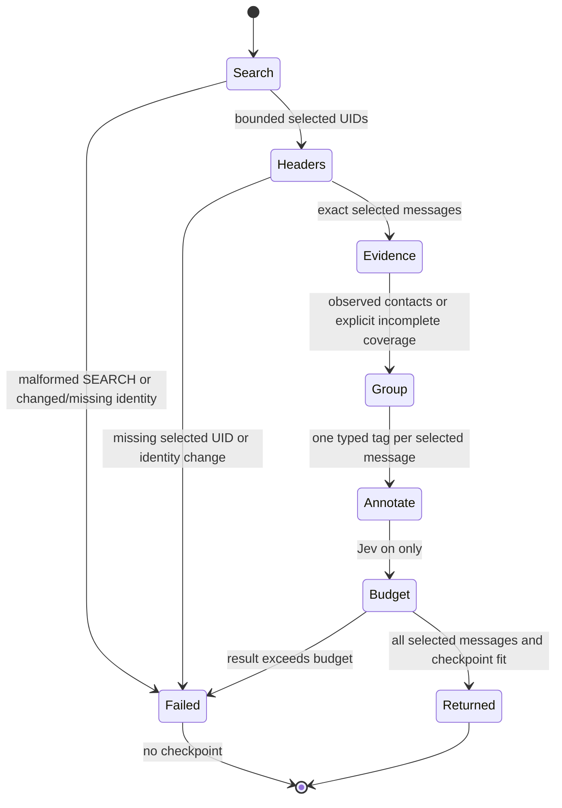

# Deterministic metadata attention brief

Issue #61 asks for a bounded daily attention view without per-message reads.
The existing summaries already expose bulk metadata. This slice groups those
summaries, with a bounded stored-Sent observation and an arrival checkpoint.
It does not claim that metadata determines urgency or that an unseen sender is
new to the user.

## Design choice

| Alternative | Result |
| --- | --- |
| Reuse `mail_get_new` and regroup its JSON | Rejected. A brief needs an explicit selected-versus-fetched completeness gate and unseen acquisition. |
| Per-sender whole-Sent candidate lookup | Rejected for this read. Up to 100 sequential sessions is excessive for a daily metadata view; complete stored headers still cannot prove lifetime absence. |
| One bounded Sent window and typed tagged items | Chosen. Positive exact matches are useful while absent or partial observations stay unknown. No cache or new native contract. |
| Remove nested items to fit the response budget | Rejected. The existing all-or-error metadata budget preserves all identities and the checkpoint together. |

The production `Brief.Item` holds one original message, one primary `Group`,
one orthogonal `Delivery`, and a raw List-Id key. Its typed tag is the partition.
The JSON `messages` array is UID ordered and carries the same tags. `groups`
contains only derived counts, not a second copy of message payloads. List and
automation signals take priority over a known correspondent; direct delivery
never changes the primary group. Duplicate classification headers do not count
as a bulk signal. An incomplete or over-4096-byte header block produces unknown
classification. Unusable sender or recipient syntax makes only that address
evidence unknown. A single nonempty raw List-Id is an untrusted list signal,
not strict RFC validation or proof of list membership.

## Statechart

An empty page skips Sent lookup. Malformed From does not suppress independent
To/Cc evidence. The next checkpoint is the last selected arrival UID (or the
input UID on an empty page). It is not a cursor over future unread-state changes.
No success path omits selected messages. Header fetching pins UIDVALIDITY in the
same session, and then verifies the complete selected UID sequence.

## Evidence and limits

- At most 100 selected messages, default 50.
- At most 50 distinct selected sender addresses matched.
- One Sent search over 30 days and at most 100 newest candidate headers.
- No body fetch for the deterministic brief. No preview, cache or native change.
- No negative lifetime claim. Exact positive observations survive partial scans.
- The existing response projector preserves metadata or returns an error.
- Mail, metadata and model annotations remain untrusted and cannot authorize writes.

The laws [brief_preserves_selected_uids](../../LAWS.bend) and
[brief_partitions_selected_uids](../../LAWS.bend) prove ordered UID identity and
per-UID multiplicity for the actual production classifier. The tagged type gives
one primary group per occurrence. Runtime acquisition deduplicates requested
UIDs and requires an exact FETCH match before classification. The law
[brief_plans_write_nothing](../../LAWS.bend) covers the new acquisition plan;
existing contact and header-plan laws cover reused reads.

`brief-model/Brief.tla` is a bounded design model, not a CI-enforced or runtime
proof. It checks that failed acquisition or budget admission cannot publish a
checkpoint, each selected UID has one group, and a people tag requires observed
positive evidence. The negative switches deliberately break those invariants.

## Review and verification

Read `src/brief.bend`, the isolated brief block in `src/tools.bend`, the schema
source, then the laws and tests. `src/schema.bend` is generated and its literal
pool changes extensively when a tool is added. Check regeneration and the exact
schema pin instead of reviewing its pooled fragment numbering by hand.

`tests/brief-cases.py` runs through both canonical CLI and structured MCP suites.
It checks exact UID coverage, group counts, direct/Cc delivery, empty and resumed
checkpoints, response-budget retries, missing FETCH, UIDVALIDITY races, partial
contact evidence, sender caps, no mailbox changes and Jev-off operation. Its
separate metadata attention task uses #133's synthetic corpus and measures at
most two tool calls. It preserves the original persona tasks and goldens. This
is not a before/after speedup or a substitute for #139's agent-quality suite.

## Remaining #61 scope

Keep #61 open for optional preview extraction and its `preview_partial` and
estimated token fields, plus the separately authorized #139 quality evaluation.
Lifetime first-time classification needs a distinct evidence contract; stored
Sent windows cannot supply it. No paid service or real mailbox was used here.
