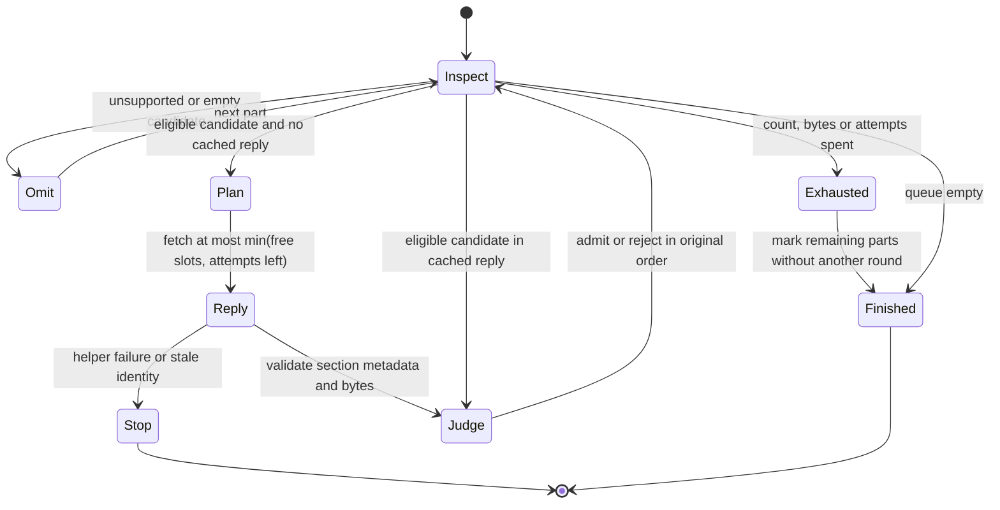

# Request-level image rounds

The request, rather than a message, owns the four-image, 1,572,864-byte and
eight-attempt quota. Its queue records each part's UID and MIME metadata.
Per-message counts preserve the partition used when final image verdicts
are attached to TypeSafe entries and agent-visible results.



This chart describes the Bend controller. `tests/formal/check-image-rounds.py`
exhausts 262,144 nine-candidate traces of a smaller byte-budget model.
Outcomes cover rejection, acceptance, exact exhaustion and an image larger
than the remaining byte budget. The model compares ordered fates and logical
attempt counts with sequential admission. It checks physical fetches at most
eight, at most five sessions, and no physical fetch after four accepted
images. It does not model MIME parsing, metadata validation, transport
failures or request splitting. End-to-end tests cover those boundaries.

If enough candidates remain, the first round takes four attempts. Any later
round takes at least one. Only four attempts can remain after the first
round, so there can be at most five sessions. A short first round means the
queue has no more eligible candidates and cannot need a replacement round.
Three accepted images and five rejected images attain the five-session bound.

The byte budget can reach exactly zero before the end of an already-issued
round. Those later bytes are not judged or sent, and their verdicts remain
`over_budget`. Logical attempt accounting follows the old sequential path.
Physical attempts still cannot exceed eight because the round's width was
reserved before issue, and exhausted bytes forbid every subsequent round.

The existing `quota_admit` and final `bind_io` stay authoritative. No quota
is reset between messages or rounds. One shared response is retained at a
time. `plan_image_round` is the only new plan entry point. Its exact prefix,
per-message metadata, selected sections and read-only effect have laws.
Every selected section is an `I.IPart`, covered by the existing
`fetch_items_never_set_seen` law.

Run the bounded controller model with:

```sh
python3 tests/formal/check-image-rounds.py
python3 tests/formal/check-plan-wire-mutations.py
```

This is an exhaustive bounded Python model, not a TLC or production-code
proof. The production image-binding proofs remain unchanged.
The separate plan mutation runner removes or reorders the UIDVALIDITY
expectation, changes the UID or section, and replaces `EXAMINE` with `SELECT`.
Each mutation must fail at its expected exact-plan law, rather than at an
unrelated parse or type error.
