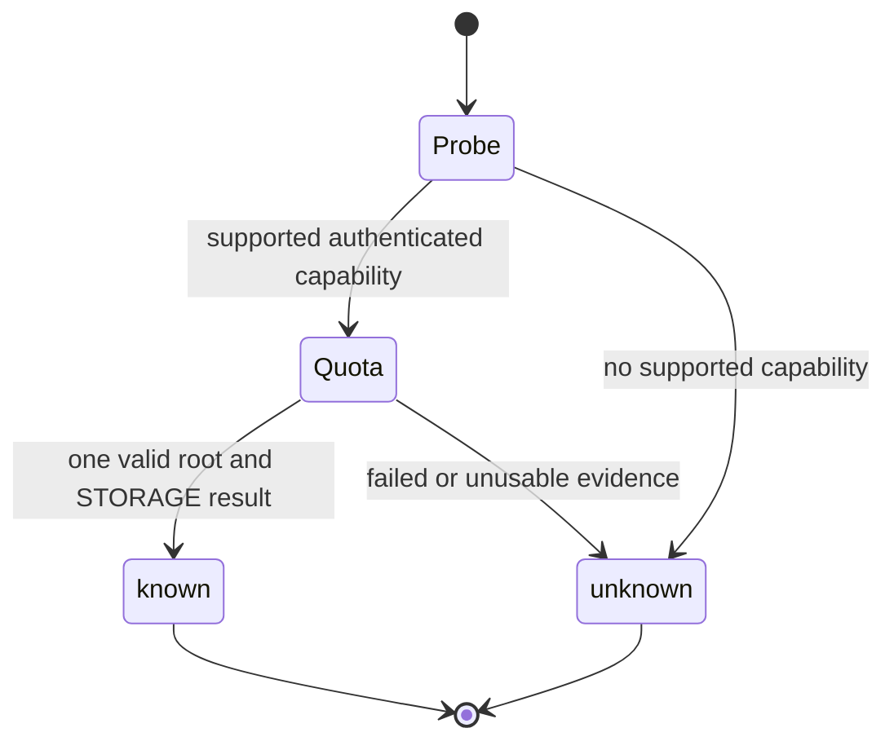

# Storage quota observations

A probe can explain storage pressure without changing a mailbox. The result
is an observation of the INBOX quota root, not an authorization or a delivery
guarantee. RFC 9208 explicitly warns that STORAGE is not an exact forecast of
which messages a server can accept.

## Standards and supported replies

[The legacy QUOTA extension](https://www.rfc-editor.org/rfc/rfc2087.html)
defines GETQUOTAROOT and STORAGE units of 1024 octets.
[The current extension](https://www.rfc-editor.org/rfc/rfc9208.html) defines
QUOTA=RES-* capabilities and the OVERQUOTA response code. Plain QUOTA is a
legacy-server signal. The gate accepts exact QUOTA or QUOTA=RES-STORAGE from
the successful a1 CAPABILITY in this call. QUOTASET, RES-MESSAGE alone, and
near matches do not cause a quota session.

The quota plan runs in one additional authenticated session. Only a successful
a1 completion can establish its observation. Exactly one QUOTAROOT must name
INBOX, case-insensitively, and exactly one QUOTA must match its root exactly.
Roots are case-sensitive. Empty, quoted, escaped, and literal roots work.
The parser never sums roots. It rejects missing roots, multiple roots,
duplicate replies or STORAGE resources, malformed resource triplets, quoted
numbers, unclosed syntax, and trailing garbage. Other complete resource
triplets are ignored after numeric validation.

The strict quota-only lexer does not change the existing forgiving IMAP parser.
It conservatively rejects bare NIL roots, non-ASCII quoted roots, and unusual
atom roots with bracket characters. Such valid but unsupported spellings report
unknown, not a fabricated empty root. Quoted or literal ASCII roots cover the
usual names. This is not a complete implementation of every IMAP astring.

## Bounds and public contract

The parser accepts at most 64 scoped reply lines. Every scoped line is bounded
at 4096 characters before field parsing. A quota line has at most 16 literals,
each at most 4096 characters. NUL literals and nested resource lists are rejected. The existing
helper transcript and time limits remain unchanged. A bound rejects the whole
observation rather than truncating it into a valid result.

Each resource value must be an unsigned decimal integer no greater than
4294967295. A zero STORAGE limit is unknown because a usable percentage is
undefined. `percent` is the exact integer floor and must also fit U32.
An unrepresentable percentage makes the observation unknown. Usage can exceed
the limit. Percentage multiplication uses quotient and remainder arithmetic
without overflowing intermediate products.

`mail_probe.storage` is either `"unknown"` or an object with `used_kib`,
`limit_kib`, and `percent`. Missing support, transport failure, refusal, and
unsupported syntax leave the rest of the successful probe intact.

The diagnostic storage check has `protocol`, `stage`, and `level` only.
The level is `full` when usage reaches the limit, `above_90_percent` when the
exact ratio exceeds 90%, and `ok` otherwise. An unavailable observation gives
`unknown`. A usage of 901 out of 1000 warns even though its integer percent is 90.
No count, root, or server text reaches this diagnostic check.

The first refused command's actual OVERQUOTA response code produces fixed
guidance to ask the account owner to free storage. A prose mention or an
unterminated response code does not.
This applies to refusals generally, including APPEND and COPY. The response
parser does not claim command provenance. A stale UIDVALIDITY error takes
precedence. SMTP acceptance remains accepted if saving the Sent copy fails.
The existing `Do not resend.` instruction and check-before-saving guidance stay.

## Statechart and assurance boundary



The bounded model in `storage-quota-model/Quota.tla` is a design note, not a
CI-gated check. It needs the external pstack `statechart` tool, which is not
installed by this repository. CI does not detect drift between this model and
the implementation. When run manually, it checks the extra-session
budget and that known results require accepted evidence. It abstracts parsing,
TLS, helper IO, and numeric validation. It does not prove those implementations.
`Broken.cfg` bypasses the capability gate and must violate CapabilityBudget.

Run from a scratch directory with an external pstack statechart installation:

```sh
statechart /path/to/MailBend/docs/plans/storage-quota-model/Quota.tla \
  --config /path/to/MailBend/docs/plans/storage-quota-model/Quota.cfg \
  --view /path/to/MailBend/docs/plans/storage-quota-model/view.ts --out quota
```

The [plan_quota_writes_nothing](../../LAWS.bend) law proves that this fixed
plan has no mailbox-writing effects. It does not prove server behavior.
The plan-wire mutation check inserts a STORE and requires that law to fail.
Parser units test strictness and numeric boundaries. Fake-server cases exercise
the CLI, structured MCP, login counts, redacted diagnose output, and refusals.

## Review order and remaining validation

1. Review the command constructor, explicit effect, quota parser, and capability
   gate in `src/imap.bend`.
2. Review `plan_quota` in `src/ops.bend` and its law and proof.
3. Review probe integration in `src/tools.bend` and the separate diagnostic
   helper path in `src/diagnostics.bend`.
4. Review synthetic parser and server tests, then the schema generator.
   `src/schema.bend` and the schema hash pin are generated changes.

No live mailbox was used. iCloud's quota root and whether its values describe
shared iCloud account storage remain unvalidated. An explicitly authorized
provider check is required to answer those questions. Issue #160 stays open.
No native helper, security setting, send policy, or deletion policy changes.
