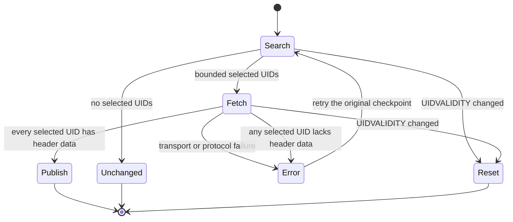

# Arrival checkpoint FETCH coverage

A polling client must not save a cursor past a selected message that was
not returned. The SEARCH and FETCH sessions can differ. A successful tagged
FETCH response alone does not prove that all selected header data arrived.

The new gate runs after the existing UIDVALIDITY check. It uses the existing
normalized FETCH list, which excludes unsolicited UIDs and headerless flag
updates, sorts by UID and deduplicates responses. Any missing selected UID
returns an error without messages or a new cursor. It does not manufacture a
partial success. A retry performs SEARCH again. A message expunged between
sessions therefore no longer needs to be fetched on that retry.

Review the small gate in `src/tools.bend` first. The existing `msg_uids`
helper only moves earlier so the gate can use it. No plans, native helpers,
response byte budgets, limits, or command permissions change.

The focused Bend regression exercises missing middle and tail UIDs,
headerless updates, duplicate and reordered responses, unsolicited UIDs, and
UIDVALIDITY reset precedence. Before the fix the missing cases returned
`next_since_uid: 9`. The CLI and MCP scenario uses the existing fake server
to omit first, middle and last selected header data, then retries the same
cursor with complete data. It also checks read-only commands and state.
